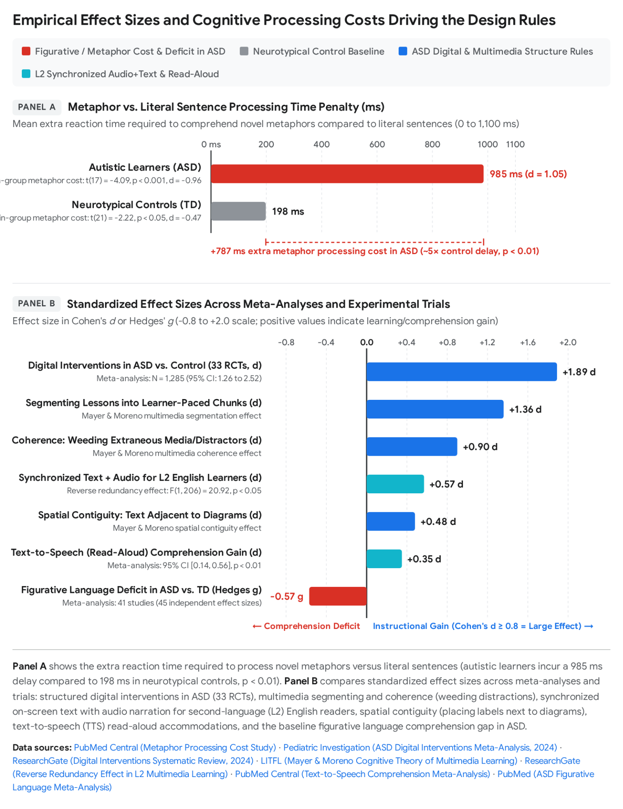

# Evidence-Based Web Design Guide for a Grade 6 Autistic Learner in an Egyptian Inclusive Language School

> Gemini Deep Research, 17 November 2026. This is the report as delivered, including its figure, recommendations, evidence labels, 51 checklist items and bibliography. The [research index](README.md) records which guidance the repository currently uses.

Designing interactive study and self-quizzing web pages for a Grade 6 student (approximately 11–12 years old) with high-functioning Autism Spectrum Disorder (ASD) in an Egyptian language school requires aligning three distinct bodies of knowledge: empirical autism intervention research, international web cognitive accessibility standards, and Egyptian inclusive education regulations[1]. Because the student attends an Egyptian language school with an inclusion division (*نظام* *الدمج* *التعليمي*), his core subjects (such as Science, Mathematics, and English) are taught in a second language, while his formal school assessments are governed by **Egyptian Ministry of Education and Technical Education (MoETE) Ministerial Decree No. 252 of 2017** (and subsequent updates through Circular 9 of 2024)[3]. Under Decree 252 of 2017, integrated autistic students with an IQ above 65 are evaluated **100% through objective questions** (*الامتحانات* *الموضوعية*)—principally Multiple-Choice Questions (MCQs) and True/False items—printed in **18-point font** with questions and answer spaces integrated on a single sheet rather than separated onto bubble sheets[3].

Every design rule in this guide is rated strictly by the strength of its underlying primary evidence so that consensus standards and exploratory findings are never conflated with clinical proof:

- **EVIDENCE-BASED**: Supported directly by peer-reviewed empirical studies, randomized controlled trials (RCTs), single-case experimental designs (SCDs), or meta-analyses conducted specifically with autistic children and adolescents, including the **National Clearinghouse on Autism Evidence and Practice (NCAEP) 2020 Third-Generation Review** (*Steinbrenner et al., 2020; Hume et al., 2021*, which remains the current, most comprehensive systematic review of 972 autism intervention studies)[5] and a **2024 meta-analysis of 33 RCTs of digital interventions in ASD** showing a large overall effect size (Cohen's d = 1.89 vs. all controls, though smaller at d = 0.73 against active controls)[8].

- **CONSENSUS**: Supported by authoritative accessibility and instructional standards—specifically **W3C WCAG 2.2** (*December 2024 W3C Recommendation*, the final normative edition of WCAG 2)[10], **W3C COGA "Making Content Usable for People with Cognitive and Learning Disabilities"** (*April 2021 Working Group Note*, which remains the current normative W3C cognitive design guide, supplemented by the *February 2026 W3C Cognitive Accessibility Research Modules Draft*)[1], **CAST Universal Design for Learning (UDL) Guidelines 3.0** (*released July 2024*, current edition)[14], **UK Government accessibility guidance** (*GOV.UK Home Office Autism Poster* and *DfE COGA Manual*)[16], **Egyptian MoETE Decree 252/2017 specifications**[3], or empirical psychometric and multimedia research conducted on broader neurodivergent or second-language student populations (such as Mayer's segmenting principle at d = 1.36, coherence/weeding at d = 0.90, spatial contiguity at d = 0.48, synchronized text-plus-audio for second-language learners at d = 0.57, and text-to-speech comprehension gains at d = 0.35)[18].

- **WEAK**: Supported only by small-sample pilot studies, qualitative case observations, unvalidated heuristic proposals, or mixed empirical findings where direct evidence for academic web interfaces in autism is thin[22].

Two areas in this guide exhibit thin direct evidence, which is an expected and honest reflection of the current literature. First, regarding **Minecraft-style themes**, while embedding a child's special interest into instruction as an antecedent scaffold is EVIDENCE-BASED[24], peer-reviewed studies specifically testing *Minecraft* with autistic pre-teens (such as a February 2026 pilot trial with 10–12-year-olds) evaluate playing the 3D game itself for social collaboration or sensory self-regulation rather than applying Minecraft visual styling to academic web pages[22]; therefore, Minecraft UI styling rules are rated CONSENSUS or WEAK. Second, regarding **Egyptian MoETE guidance**, full technical exam-paper specifications under Ministerial Decree No. 252 of 2017 are published primarily in Arabic administrative circulars rather than English online portals[3], though core parameters (100% objective format, 18pt font, single-sheet layout, and second-foreign-language exemption) are verified via both Arabic ministerial texts and a March 2025 British Council and MoETE policy review[3]. Furthermore, across all topics, quantitative evidence highlights why strict linguistic and visual discipline is essential: autistic learners face a baseline figurative language comprehension gap (Hedges' g = -0.57) and incur a 985 ms reaction-time penalty when processing novel metaphors compared to 198 ms in neurotypical controls (d = 1.05)[31].

## 1. Layout and Predictability

Autistic learners exhibit heightened sensitivity to visual complexity and unexpected layout changes; eye-tracking and usability studies indicate that inconsistent scanpaths, unbordered sections, and shifting controls induce anxiety and rapid task abandonment[17]. Furthermore, because the student's formal Egyptian school exams under Ministerial Decree No. 252 of 2017 use a single-sheet layout where questions and answers appear together in 18-point type[3], his interactive web pages should mirror that exact structural predictability so that study habits transfer seamlessly to school exam conditions[36]. In practice, every page should follow a uniform spatial blueprint: a predictable single-column container on a soft off-white, cream, or pale sage-gray background enclosed by clean dark-slate or warm earthy borders[34]. In the lesson view (displaying one concept per screen), a top bar shows the lesson title and a block-style progress tracker (e.g., "Progress: Block 2 of 4"), while the bordered central card places a sharp instructional diagram on the left and 2–3 bullet points of 18pt ragged-right literal text on the right, accompanied by a consistent "Listen to Page (1.0x)" audio bar and descriptive bottom navigation buttons ("Back to Block 1" and "Go to Quiz Question 1")[1]. When transitioning to the quiz view, the outer header, progress bar, and footer shell remain in the exact same coordinates, while the central box presents one 3-option MCQ or True/False item at a time with explicit radio-button instructions ("Choose one option") and neutral gray strike-through exclusion if a wrong option is selected[16].

| **Rule** | **Strength** | **Source (with link and year)** | **How to check it on a page (a yes/no test)** |
| --- | --- | --- | --- |
| **L1. Use a single-column layout with one micro-task per screen:** Present content in a single vertical column and scope each view to a single lesson concept or a single quiz question rather than multi-column grids or long scrolling pages. | **EVIDENCE-BASED** (autism UI studies) & **CONSENSUS** (DfE COGA) | [Pavlov (2014)](https://www.scirp.org/journal/paperinformation?paperid=43152)[39]; [Hassell Inclusion / Autism Web Guidelines (2024)](https://hassellinclusion.com/blog/autism-accessibility-guidelines-resource/)[34]; [UK DfE COGA Manual (2024)](https://accessibility.education.gov.uk/guidelines/coga)[16] | **Yes/No:** Is all lesson and quiz content arranged in a single vertical column displaying only one concept or question per view without requiring more than one screen-height of vertical scrolling (and zero horizontal scrolling at 320px width)? |
| **L2. Enclose every functional section in an explicit border or wireframe box:** Separate the header, lesson text/diagram box, audio toolbar, and quiz card using visible solid borders (1px–2px lines) and generous whitespace, because unbordered floating elements cause visual blurring and scanpath disorientation for autistic users. | **EVIDENCE-BASED** | [Hassell Inclusion / Autism Web Guidelines (2024)](https://hassellinclusion.com/blog/autism-accessibility-guidelines-resource/)[34]; [Interactive Story ASD UI Study (2023/2026)](https://www.researchgate.net/publication/373922366_User_Interface_Design_of_an_Interactive_Story_Application_for_Autistic_Children_and_Parents)[38]; [W3C COGA Pattern 4.4.10 (2021, current version)](https://www.w3.org/TR/coga-usable/)[1] | **Yes/No:** Does every distinct functional area on the page (navigation header, lesson card, media bar, quiz container) have a visible enclosing border or distinct container box separated by at least 16px–24px of whitespace? |
| **L3. Keep navigation and control locations identical across every page:** Place the page title/heading, progress indicator, "Back" button, "Read Aloud" button, and primary "Next / Check Answer" button in the exact same screen coordinates and visual style on every lesson and quiz page. | **EVIDENCE-BASED** (autism heuristics) & **CONSENSUS** (WCAG 2.2 / COGA) | [Khowaja & Salim (2015)](https://journals.plos.org/plosone/article?id=10.1371/journal.pone.0132187)[35]; [GOV.UK Home Office Autism Poster (2024)](https://ukhomeoffice.github.io/accessibility-posters/autism)[17]; [W3C COGA Patterns 4.2.2 & 4.2.3 (2021, current version)](https://www.w3.org/TR/coga-usable/)[1]; [WCAG 2.2 SC 3.2.3 & 3.2.4 (2024)](https://www.w3.org/TR/WCAG22/)[11] | **Yes/No:** If you toggle rapidly between any two lesson or quiz pages, do the header, progress bar, help/audio controls, and navigation buttons stay in the exact same position with identical styling? |
| **L4. Use descriptive, action-explicit button labels:** Label every button with its exact outcome (e.g., "Go to Part 2: Photosynthesis", "Check My Answer", "Next Question (2 of 5)") rather than vague labels like "Continue", "Submit", or unlabeled icons. | **EVIDENCE-BASED** (autism UI studies) & **CONSENSUS** (GOV.UK / COGA) | [GOV.UK Home Office Autism Poster (2024)](https://ukhomeoffice.github.io/accessibility-posters/autism)[17]; [Pavlov (2014)](https://www.scirp.org/journal/paperinformation?paperid=43152)[39]; [W3C COGA Pattern 4.5.6 (2021, current version)](https://www.w3.org/TR/coga-usable/)[1] | **Yes/No:** Does every interactive button contain both an icon and explicit text that states exactly what will happen when clicked? |
| **L5. Set body typography to at least 18pt (24px) sans-serif with ragged-right alignment:** Use a single clean sans-serif font (e.g., Verdana, Arial, or Lexend) at ≥18pt (24px / 1.5rem, matching Egypt's official inclusion exam specification for autistic students), left-aligned (ragged right) for English or right-aligned (ragged left) for Arabic, with line spacing ≥1.5 and bold used sparingly for key terms only. | **EVIDENCE-BASED** (autism UI) & **CONSENSUS** (Egyptian MoETE standard) | [British Council & Egyptian MoETE Inclusion Report (2025)](https://www.britishcouncil.org/sites/default/files/leading_inclusion_and_belonging_in_schools.pdf)[4]; [Pavlov (2014)](https://www.scirp.org/journal/paperinformation?paperid=43152)[39]; [Dattolo & Luccio (2017)](https://www.researchgate.net/publication/318426543_A_Review_of_Websites_and_Mobile_Applications_for_People_with_Autism_Spectrum_Disorders_Towards_Shared_Guidelines)[41] | **Yes/No:** Is all body and question text rendered in a sans-serif font at 24px (18pt) or larger, with ragged-right (unjustified) alignment, zero word hyphenation across line breaks, and no italics or ALL CAPS used for emphasis? |
| **L6. Make interactive targets large and visually clickable:** Ensure all buttons, MCQ option cards, and True/False selectors have a clear raised/bordered button affordance and a large click/tap area (at least 44px × 44px, exceeding the WCAG 2.2 minimum of 24px × 24px) so motor precision never impedes answering. | **EVIDENCE-BASED** (GAIA autism framework) & **CONSENSUS** (WCAG 2.2) | [Britto & Pizzolato GAIA / Blanco et al. (2023/2024)](https://www.researchgate.net/publication/374061934_Design_of_a_mathematical_problem-solving_application_for_students_with_autism_spectrum_disorder)[42]; [WCAG 2.2 SC 2.5.8 Target Size (2024)](https://www.w3.org/TR/WCAG22/)[11] | **Yes/No:** Is the entire container box of each MCQ or True/False option clickable (measuring at least 44px tall with a visible border and hover/focus outline), rather than requiring the child to click a small radio circle? |

## 2. Language (Literal, Short)

Meta-analytic and eye-tracking evidence indicates that figurative language imposes a heavy cognitive tax on autistic learners. Across 41 studies (45 effect sizes), autistic individuals show poorer comprehension of figurative language overall compared to neurotypical peers (Hedges' g = -0.57), with metaphors posing a sharper barrier than irony or sarcasm (g = -0.63 across 14 metaphor studies) and yielding 7.5-fold lower odds of accurate comprehension than matched literal statements[32]. Even when linguistically able autistic readers successfully decode a metaphor, a 2025 eye-tracking and reaction-time study demonstrated that their processing cost averages **985 ms** per metaphor compared to **198 ms** for neurotypical controls (Cohen's d = 1.05)—an ~800 ms cognitive delay per figurative phrase that drains working memory needed for Grade 6 academic concepts[31].

| **Rule** | **Strength** | **Source (with link and year)** | **How to check it on a page (a yes/no test)** |
| --- | --- | --- | --- |
| **LG1. Use 100% literal language; eliminate all metaphors, idioms, irony, and figures of speech:** State every scientific, historical, or mathematical concept and every instruction literally (e.g., write *"The mitochondria produce energy for the cell"* rather than *"The mitochondria are the powerhouses that keep the cell's lights on"* unless "powerhouse" is explicitly taught as a textbook analogy). | **EVIDENCE-BASED** | [Kalandadze et al. Meta-Analysis (2018)](https://pubmed.ncbi.nlm.nih.gov/27899711/)[32]; [Metaphor Processing Cost Eye-Tracking Study in ASD (2025)](https://pmc.ncbi.nlm.nih.gov/articles/PMC12860833/)[31]; [W3C COGA Pattern 4.4.4 (2021, current version)](https://www.w3.org/TR/coga-usable/)[1]; [GOV.UK Home Office Autism Poster (2024)](https://ukhomeoffice.github.io/accessibility-posters/autism)[17] | **Yes/No:** Can every sentence on the page be interpreted word-for-word literally without containing any unexplained idiom, figure of speech, sarcasm, or playful metaphor? |
| **LG2. Keep sentences short (≤15–20 words) and place one main clause per line or bullet:** Break explanations into short, consecutive sentences (targeting ≤15 words per sentence where possible, and never exceeding 25 words) formatted as bulleted lists rather than dense paragraphs ("walls of text"). | **EVIDENCE-BASED** (autism reading UI) & **CONSENSUS** (GOV.UK / COGA) | [Pavlov (2014)](https://www.scirp.org/journal/paperinformation?paperid=43152)[39]; [Dattolo & Luccio (2017)](https://www.researchgate.net/publication/318426543_A_Review_of_Websites_and_Mobile_Applications_for_People_with_Autism_Spectrum_Disorders_Towards_Shared_Guidelines)[41]; [GOV.UK Home Office Autism Poster (2024)](https://ukhomeoffice.github.io/accessibility-posters/autism)[17]; [W3C COGA Pattern 4.4.5 (2021, current version)](https://www.w3.org/TR/coga-usable/)[1] | **Yes/No:** Are all explanatory paragraphs replaced with bullet points or short blocks of 2–3 sentences where every sentence is 20 words or fewer? |
| **LG3. Use active voice, simple present/past tense, and positive phrasing:** Write explanations and instructions in direct active voice (*"Plants absorb water through their roots"*) and avoid passive constructions, nested relative clauses, conditionals, or double negatives. | **CONSENSUS** (COGA & L2 item simplification research) | [W3C COGA Patterns 4.4.2 & 4.4.3 (2021, current version)](https://www.w3.org/TR/coga-usable/)[1]; [Abedi et al. / CMU Item-Writing Research Review (2019)](https://metals.hcii.cmu.edu/wp-content/uploads/2019/12/How-to-Write-a-Multiple-Choice-Question-According-to-the-Research.pdf)[21] | **Yes/No:** Is every sentence on the page written in the active voice without double negatives or nested subordinate clauses? |
| **LG4. Pre-teach and inline-define new curriculum vocabulary before the lesson text:** Provide a "Key Words" box at the top of the lesson (and clickable inline glossary definitions) that defines unfamiliar Grade 6 technical terms and abbreviations in plain language before they appear in the explanation or quiz. | **EVIDENCE-BASED** (structural language in ASD) & **CONSENSUS** (UDL 3.0 / CTML Pre-training) | [Kalandadze et al. (2018/2021)](https://d-nb.info/1232474835/34)[44]; [CAST UDL Guidelines 3.0 Consideration 2.1 (2024)](https://udlguidelines.cast.org/representation/language-symbols/)[14]; [Mayer CTML Pre-training Principle (2025 review)](https://edtechuvic.ca/edci337/2025/09/05/theories-of-multimedia-learning/)[19]; [WCAG 2.2 SC 3.1.3 & 3.1.4 (2024)](https://www.w3.org/TR/WCAG22/)[11] | **Yes/No:** Are all technical curriculum terms and abbreviations defined in a visible Key Words box at the start of the lesson or via an inline definition on the same screen? |
| **LG5. Write all numbers as Arabic numerals (3, 12) rather than words or Roman numerals:** Represent quantities, steps, and measurements using digits (3 parts, Step 1) rather than spelled-out number words (three) or Roman numerals (III), which reduce scanning effort for autistic readers. | **EVIDENCE-BASED** | [Pavlov (2014)](https://www.scirp.org/journal/paperinformation?paperid=43152)[39]; [W3C COGA Objective 3 (2021, current version)](https://www.w3.org/TR/coga-usable/)[1] | **Yes/No:** Are all numbers on the page (including numbers below 10) written as digits (1, 2, 3) with zero Roman numerals (I, II, III)? |

## 3. Visuals and Dual Coding

Visual Supports and Technology-Aided Instruction and Intervention (TAII) are both classified as **Evidence-Based Practices** in the NCAEP 2020 systematic review[24]. Autistic children demonstrate strong visual cognition advantages[51], and pairing text with structured visual representations—such as graphic organizers, concept maps, and clear diagrams—compensates for executive function and central coherence challenges during reading comprehension[52]. However, studies of autistic interfaces show that **low-to-moderate visual fidelity** (clean vector diagrams, clear schematic drawings, or sharp, isolated photos) outperforms cluttered, photorealistic, or overlapping graphics[39].

| **Rule** | **Strength** | **Source (with link and year)** | **How to check it on a page (a yes/no test)** |
| --- | --- | --- | --- |
| **V1. Pair every core lesson text block with one clear, instructional diagram or graphic organizer:** Accompany verbal explanations with a directly relevant visual (labelled diagram, cause-and-effect flowchart, or concept map) that illustrates the exact relationship described in the text. | **EVIDENCE-BASED** | [Steinbrenner et al. NCAEP Report (2020, current version)](https://ncaep.fpg.unc.edu/wp-content/uploads/EBP-Report-2020.pdf)[2]; [Tárraga-Mínguez et al. Systematic Review (2021)](https://pmc.ncbi.nlm.nih.gov/articles/PMC7824210/)[52]; [Britto & Pizzolato GAIA (2016/2024)](https://www.researchgate.net/publication/374061934_Design_of_a_mathematical_problem-solving_application_for_students_with_autism_spectrum_disorder)[42] | **Yes/No:** Does every lesson explanation screen include a diagram, graphic organizer, or instructional image that directly depicts the concept taught in the text? |
| **V2. Place instructional images immediately beside their corresponding text (Spatial Contiguity):** Position the supporting picture on the left and the corresponding explanatory text immediately to its right (for LTR English pages; reversed for RTL Arabic) inside the same container, integrating labels directly onto diagram parts so the student never has to cross-reference a separate legend. | **EVIDENCE-BASED** (autism UI & split-attention studies) | [Pavlov (2014)](https://www.scirp.org/journal/paperinformation?paperid=43152)[39]; [Split-Attention CBI Autism Study (2013)](https://files.eric.ed.gov/fulltext/EJ1015429.pdf)[55]; [Mayer Spatial Contiguity Principle (d = 0.48)](https://litfl.com/cognitive-theory-of-multimedia-learning/)[19] | **Yes/No:** Are all supporting images placed directly beside their matching text with diagram labels attached directly to the parts they name (no separate numbered key/legend)? |
| **V3. Use clean, high-contrast schematic illustrations or isolated sharp photographs (low-to-moderate visual fidelity):** Use crisp vector diagrams or isolated subject photos on a plain background rather than busy real-world scenes, overlapping transparent images, or abstract visual metaphors. | **EVIDENCE-BASED** | [ASD App UI Design Study (2025)](https://pmc.ncbi.nlm.nih.gov/articles/PMC11894442/)[51]; [Dattolo & Luccio (2017)](https://www.researchgate.net/publication/318426543_A_Review_of_Websites_and_Mobile_Applications_for_People_with_Autism_Spectrum_Disorders_Towards_Shared_Guidelines)[41]; [Pavlov (2014)](https://www.scirp.org/journal/paperinformation?paperid=43152)[39] | **Yes/No:** Is every image on the page in sharp focus with a plain or cleanly isolated background, free of clutter, irrelevant people, or overlapping semi-transparent layers? |
| **V4. Highlight critical features using visual signaling cues:** Use arrows, numbered step badges, bold callout boxes, or a distinct border highlight around key diagram components to direct selective attention to the most important concept on the screen. | **EVIDENCE-BASED** (ASD interface studies) & **CONSENSUS** (UDL 3.0 / Signaling Principle) | [ASD App UI Design Study (2025)](https://pmc.ncbi.nlm.nih.gov/articles/PMC11894442/)[51]; [Split-Attention CBI Autism Study (2013)](https://files.eric.ed.gov/fulltext/EJ1015429.pdf)[55]; [CAST UDL Guidelines 3.0 Consideration 3.2 (2024)](https://udlguidelines.cast.org/representation/building-knowledge/)[14]; [Signaling Principle (2025)](https://www.digitallearninginstitute.com/blog/mayers-principles-multimedia-learning)[56] | **Yes/No:** Are the 1–3 critical features of any diagram or lesson step visually emphasized with arrows, numbered badges, or callout borders? |
| **V5. Exclude purely decorative images and large "hero" banners above the fold:** Omit decorative clip art, stock photos of faces looking at the camera, and wide top banners that push lesson content down the page. | **EVIDENCE-BASED** (autism web usability) & **CONSENSUS** (Coherence Principle) | [Hassell Inclusion / Autism Web Guidelines (2024)](https://hassellinclusion.com/blog/autism-accessibility-guidelines-resource/)[34]; [Mayer Coherence Principle (d = 0.90)](https://litfl.com/cognitive-theory-of-multimedia-learning/)[19] | **Yes/No:** Does every image on the page serve a direct instructional or navigational function (zero decorative banners or filler clip art)? |

## 4. Colour

Empirical research on colour perception in autism shows that sensory hyper-reactivity alters visual comfort[58]. In a clinical comparison of 29 boys with ASD aged 4–17 (including an 11–17-year-old subgroup) against 38 age-matched neurotypical boys across six colours, **Grandgeorge & Masataka (2016)** found that autistic boys were **significantly less likely to prefer yellow**—which the authors attribute to visual hyper-sensation making high-luminance yellow sensory-overloading—and **significantly more likely to prefer green and brown**[58]. Fortunately, green and brown are the foundational earthy tones of *Minecraft* (grass blocks, oak wood, stone), making a muted, low-saturation earthy palette naturally aligned with both clinical autism colour research and the student's preferred theme[38].

| **Rule** | **Strength** | **Source (with link and year)** | **How to check it on a page (a yes/no test)** |
| --- | --- | --- | --- |
| **C1. Use a muted, low-saturation palette dominated by cool/earthy tones (greens, browns, soft blues, neutral grays) and avoid bright yellow:** Style structural frames, headers, and cards using soft, low-saturation greens, browns, and slate blues while avoiding high-luminance neon hues and bright yellow backgrounds. | **EVIDENCE-BASED** | [Grandgeorge & Masataka (2016)](https://pubmed.ncbi.nlm.nih.gov/28066297/)[58]; [Interactive Story ASD UI Study (2023/2026)](https://www.researchgate.net/publication/373922366_User_Interface_Design_of_an_Interactive_Story_Application_for_Autistic_Children_and_Parents)[38]; [Mohamed et al., Egyptian Inclusive UX Color Study (2025)](https://www.jadm.eg.net/journal/vol4/iss1/3/)[61]; [GOV.UK Home Office Autism Poster (2024)](https://ukhomeoffice.github.io/accessibility-posters/autism)[17] | **Yes/No:** Is the page free of bright/neon colours and large yellow surfaces, using a muted palette of no more than 3–4 coordinated colours? |
| **C2. Use dark text on a soft off-white/tinted background with a contrast ratio ≥4.5:1 (avoid pure #FFFFFF white glare):** Maintain dark charcoal text on a soft cream, pale sage, or warm light-gray background that achieves at least a 4.5:1 WCAG contrast ratio without the harsh luminance of pure white (#FFFFFF) against pure black (#000000). | **EVIDENCE-BASED** (autism UI) & **CONSENSUS** (GOV.UK / WCAG 2.2) | [GOV.UK Home Office Autism Poster (2024)](https://ukhomeoffice.github.io/accessibility-posters/autism)[17]; [Pavlov (2014)](https://www.scirp.org/journal/paperinformation?paperid=43152)[39]; [Ludlow et al. (2006/2012)](https://www.semanticscholar.org/paper/Atypical-Color-Preference-in-Children-with-Autism-Grandgeorge-Masataka/5da31a90f6a8f390514e2787a373be76fde6cdb1)[60] | **Yes/No:** Does body text use dark print on a soft non-glare light background with a measured contrast ratio between 4.5:1 and 15:1? |
| **C3. Apply consistent functional colour coding paired with explicit shapes/icons:** Use the exact same colour role across all pages (e.g., muted blue for primary action buttons, soft amber for "Key Word / Hint" boxes, muted green for confirmed correct answers) and always pair colour with an icon or text label so meaning never relies on colour alone (autistic learners show reduced chromatic target discrimination on coloured backgrounds). | **EVIDENCE-BASED** (chromatic discrimination & CBI studies in ASD) & **CONSENSUS** (COGA) | [Franklin et al. / Chromatic Discrimination in ASD](https://jov.arvojournals.org/article.aspx?articleid=2139939)[60]; [Split-Attention CBI Autism Study (2013)](https://files.eric.ed.gov/fulltext/EJ1015429.pdf)[55]; [W3C COGA Objective 1 (2021, current version)](https://www.w3.org/TR/coga-usable/)[1] | **Yes/No:** If the page is viewed in grayscale, is every status state, key-word callout, and interactive button still 100% distinguishable by its text label, border, or icon? |
| **C4. Provide a one-click background tint / contrast switcher:** Include a persistent, simple display toggle allowing the student (or his inclusion teacher) to switch between 2–3 calm background presets (e.g., Soft Cream, Pale Sage Green, Warm Slate). | **EVIDENCE-BASED** (autism accessibility reviews) & **CONSENSUS** (UDL 3.0 / DfE COGA) | [Sensory Processing & Colour Preference in ASD (2025)](https://ideas.repec.org/a/pal/palcom/v12y2025i1d10.1057_s41599-025-05753-4.html)[59]; [RBIE Systematic Mapping of ASD Interfaces (2026)](https://journals-sol.sbc.org.br/index.php/rbie/article/view/7245)[65]; [CAST UDL 3.0 Consideration 1.1 (2024)](https://udlguidelines.cast.org/representation/perception/)[14]; [UK DfE COGA Manual (2024)](https://accessibility.education.gov.uk/guidelines/coga)[16] | **Yes/No:** Is there a visible setting control that lets the user change the page background tint and saves that preference across pages? |

## 5. Motion and Sound

Unexpected auditory stimuli, background music, and autonomous screen animations frequently trigger sensory distress or attentional fixation in autistic children[41]. At the same time, **Khowaja & Salim (2015)** found that **System Responsiveness** was the single most frequently violated heuristic in software for autistic children: when an interface lags after a click, autistic learners quickly lose attentional engagement or click repeatedly[35]. When deterministic motion is used (such as a step-by-step science diagram), research on autistic systemizing shows that **predictable, user-triggered mechanical motion** is comfortable and informative, whereas unpredictable or autonomous motion is stressful[68].

| **Rule** | **Strength** | **Source (with link and year)** | **How to check it on a page (a yes/no test)** |
| --- | --- | --- | --- |
| **MS1. Prohibit all auto-playing audio, background music, and ambient sound effects:** Never play music, voiceovers, or ambient sounds automatically on page load or during reading; all audio must be initiated strictly by an explicit user click and include a dedicated mute/stop button. | **EVIDENCE-BASED** (autism UI studies) & **CONSENSUS** (WCAG 2.2 / COGA) | [Fletcher-Watson et al. (2016)](https://scispace.com/pdf/designing-for-young-children-with-autism-spectrum-disorder-a-4weupjai3m.pdf)[66]; [Dattolo & Luccio Guideline G5 (2017)](https://www.researchgate.net/publication/318426543_A_Review_of_Websites_and_Mobile_Applications_for_People_with_Autism_Spectrum_Disorders_Towards_Shared_Guidelines)[41]; [WCAG 2.2 SC 1.4.2 Audio Control (2024)](https://www.w3.org/TR/WCAG22/)[11]; [UK DfE COGA Manual (2024)](https://accessibility.education.gov.uk/guidelines/coga)[16] | **Yes/No:** When the page loads and sits idle or is scrolled, is it completely silent until the user explicitly clicks an audio button? |
| **MS2. Eliminate all continuous, blinking, floating, or decorative animations and respect prefers-reduced-motion:** Do not use moving text, blinking icons, parallax scrolling, animated mascots, or animated loading screens (which Fletcher-Watson et al. note can cause autistic users to fixate on the loader rather than the lesson). | **EVIDENCE-BASED** (autism app trials) & **CONSENSUS** (WCAG 2.2 / COGA) | [Fletcher-Watson et al. (2016)](https://scispace.com/pdf/designing-for-young-children-with-autism-spectrum-disorder-a-4weupjai3m.pdf)[66]; [Pavlov (2014)](https://www.scirp.org/journal/paperinformation?paperid=43152)[39]; [Dattolo & Luccio Guideline G5 (2017)](https://www.researchgate.net/publication/318426543_A_Review_of_Websites_and_Mobile_Applications_for_People_with_Autism_Spectrum_Disorders_Towards_Shared_Guidelines)[41]; [WCAG 2.2 SC 2.2.2 (2024)](https://www.w3.org/TR/WCAG22/)[11]; [UK DfE COGA Manual (2024)](https://accessibility.education.gov.uk/guidelines/coga)[16] | **Yes/No:** Is the screen 100% static when the user is not interacting with it (zero looping GIFs, bouncing icons, or moving backgrounds), and does the CSS honour @media (prefers-reduced-motion: reduce)? |
| **MS3. Make instructional animations step-by-step and user-controlled:** When a dynamic process must be shown (e.g., how a circuit closes or how fractions combine), present it as a user-stepped sequence ("Step 1" → "Step 2") or a Play/Pause scrubbable animation rather than an unstoppable video. | **EVIDENCE-BASED** (autism systemizing & UI studies) & **CONSENSUS** (CTML Segmenting) | [Golan et al. / Baron-Cohen Systemizing Study (2010)](https://www.researchgate.net/publication/26821354_Enhancing_Emotion_Recognition_in_Children_with_Autism_Spectrum_Conditions_An_Intervention_Using_Animated_Vehicles_with_Real_Emotional_Faces)[68]; [Khowaja & Salim Control Heuristic (2015)](https://journals.plos.org/plosone/article?id=10.1371/journal.pone.0132187)[35]; [Mayer Segmenting Principle (d = 1.36)](https://litfl.com/cognitive-theory-of-multimedia-learning/)[19] | **Yes/No:** Does every instructional animation or video have visible Play, Pause, and Step/Replay buttons controlled entirely by the learner? |
| **MS4. Guarantee instant visual response (<100 ms) to every click with debounced input protection:** Provide an immediate, calm visual state change (border highlight or button depression) the instant an option is clicked, and debounce rapid double-clicks so accidental repeated taps do not skip a question. | **EVIDENCE-BASED** | [Khowaja & Salim Responsiveness Heuristic (2015)](https://journals.plos.org/plosone/article?id=10.1371/journal.pone.0132187)[35]; [Britto & Pizzolato GAIA G7 & G10 / Blanco et al. (2023/2024)](https://www.researchgate.net/publication/374061934_Design_of_a_mathematical_problem-solving_application_for_students_with_autism_spectrum_disorder)[42] | **Yes/No:** Does clicking any option or button produce an immediate visual state change with zero lag, and does double-clicking a button prevent accidentally skipping the next screen? |

## 6. Feedback After Wrong Answers

How a learning interface responds to an incorrect answer is critical for an autistic Grade 6 student. Two distinct findings from autism research must be synthesized here:

- **Non-Punitive, Non-Sensory Error Handling**: In co-design and RCT evaluations of educational software for autistic children, **Fletcher-Watson et al. (2016)** established that interfaces should **avoid punitive feedback** (no harsh buzzers, red flashing screens, sad faces, or point deductions), and avoid playing novel sound effects or funny animations on wrong answers—because some autistic children find novel error effects rewarding and may **choose wrong answers repeatedly** just to trigger the reaction[66].

- **Explicit Error Correction with Option Exclusion**: In a Randomized Clinical Trial (N = 28) comparing **Error Correction** against **Errorless Learning** (most-to-least prompting) in autistic children with strong vocabulary scores (standard score > 75, matching a high-functioning Grade 6 profile), **Leaf et al. (2020)** found that **Error Correction produced significantly more independent correct responses** (Mann-Whitney U = 53, p = 0.039) than errorless learning, with near-zero frustration behaviors[72]. Similarly, **Direct Instruction (DI)**—an NCAEP 2020 Evidence-Based Practice—relies on systematic, explicit error correction[50], and **Agnoli (2021)** demonstrated that in multiple-choice testing for autism, immediately neutralizing/excluding the chosen wrong option on a 3-option MCQ and prompting the student to re-read and try once more prevents perseverative errors and captures true knowledge[40].

| **Rule** | **Strength** | **Source (with link and year)** | **How to check it on a page (a yes/no test)** |
| --- | --- | --- | --- |
| **FB1. Keep wrong-answer feedback completely non-punitive and free of novel sound/animation effects:** When the student selects an incorrect option, do not play a buzzer/error sound, do not flash red or show a sad face/thumbs-down icon, and do not deduct already-earned progress tokens. | **EVIDENCE-BASED** | [Fletcher-Watson et al. (2016)](https://scispace.com/pdf/designing-for-young-children-with-autism-spectrum-disorder-a-4weupjai3m.pdf)[66]; [Britto & Pizzolato GAIA G9 (2016/2024)](https://www.researchgate.net/publication/374061934_Design_of_a_mathematical_problem-solving_application_for_students_with_autism_spectrum_disorder)[42] | **Yes/No:** When a wrong answer is submitted, does the interface remain silent (or calmly read the hint text if TTS is active), without deducting points, flashing red, or playing any animation/sound effect? |
| **FB2. Provide immediate, action-oriented corrective scaffolding that explains** ***why*** **and points back to the lesson clue:** Instead of merely saying "Incorrect", display a calm, specific hint box directly beside the question (e.g., "Not quite. Remember from Block 2: plant cells have a rigid cell wall, while animal cells do not.") that models the exact rule needed. | **EVIDENCE-BASED** (RCT in high-functioning ASD & NCAEP DI) & **CONSENSUS** (UDL 3.0) | [Leaf et al. RCT (2020)](https://pmc.ncbi.nlm.nih.gov/articles/PMC7343685/)[72]; [Steinbrenner et al. NCAEP Direct Instruction EBP (2020, current version)](https://pmc.ncbi.nlm.nih.gov/articles/PMC8510990/)[2]; [CAST UDL 3.0 Consideration 8.5 Action-Oriented Feedback (2024)](https://udlguidelines.cast.org/engagement/effort-persistence/feedback/)[14]; [WCAG 2.2 SC 3.3.1 & 3.3.3 (2024)](https://www.w3.org/TR/WCAG22/)[11] | **Yes/No:** Does selecting a wrong answer immediately display a specific, literal explanation of the concept or direct clue from the lesson rather than a generic "Wrong / Try Again" message? |
| **FB3. Visually disable (strike through and dim) the selected wrong option on 3-option MCQs and allow one guided retry; on 2-option True/False items, show the full worked correction immediately:** For 3-option MCQs, grey out and disable the wrong choice so the student cannot click the same error again and let him choose between the remaining options (up to 1 retry). For 2-option True/False questions (where a retry would be a 100% guess), immediately reveal the correct answer with a clear explanation and a "Got It — Next Question" button. | **EVIDENCE-BASED** | [Agnoli, Multiple-Choice Tests with Correction Allowed in Autism (2021)](https://www.researchgate.net/publication/356253281_Multiple-Choice_Tests_with_Correction_Allowed_in_Autism_An_Excel_Applet)[40]; [Leaf et al. RCT (2020)](https://pmc.ncbi.nlm.nih.gov/articles/PMC7343685/)[72] | **Yes/No:** On a 3-option MCQ, does a wrong selection disable/grey out that option for a second attempt, and on a True/False item, does a wrong selection immediately show the worked explanation without allowing blind guessing? |
| **FB4. Provide a one-click "Review Lesson Block" button inside the quiz feedback box:** Allow the student to view or pop open the exact lesson paragraph/diagram that answers the question without losing his place in the quiz. | **CONSENSUS** (W3C COGA & UDL 3.0) | [W3C COGA Patterns 4.5.2 & 4.7.5 (2021, current version)](https://www.w3.org/TR/coga-usable/)[1]; [UK DfE COGA Manual (2024)](https://accessibility.education.gov.uk/guidelines/coga)[16]; [CAST UDL 3.0 Consideration 8.5 (2024)](https://udlguidelines.cast.org/engagement/effort-persistence/feedback/)[14] | **Yes/No:** Does the feedback area include a button or expandable panel that displays the relevant lesson snippet/diagram without resetting quiz progress? |

## 7. Rewards and Interest-Based Themes (Minecraft-Style Themes)

This section requires careful distinction between **broad special-interest evidence** and **Minecraft-specific evidence**:

- **Broad Special Interests (EVIDENCE-BASED)**: **Antecedent-Based Interventions (ABI)** and **Reinforcement** are core NCAEP 2020 Evidence-Based Practices[24]. Systematic reviews (**Gunn & Delafield-Butt, 2016**; **Wood, 2021**) and single-case experimental trials (**Dahlbäck, 2022**; **2024 SIA Multiple-Baseline Study**) indicate that embedding a student's Special Interest Area (SIA) directly into the *antecedent* instructional materials is more effective at sustaining on-task academic behavior than using the interest merely as an external post-task reward[27]. Furthermore, a **2024 pre-registered eye-tracking study (N = 44 autistic children)** demonstrated that personalized focused-interest visuals **do not distract or disrupt word learning**[25], and an **August 2026 study in** ***Frontiers in Psychiatry*** revealed that in intellectually able autistic individuals, intense interests function primarily as **intrinsic knowledge-seeking and systemizing** (52% of accounts) rather than mere self-regulation (9%)[75].

- **Minecraft-Specific Theme Evidence (CONSENSUS / WEAK)**: As expected, direct peer-reviewed evidence on *Minecraft* in autism—such as **Thirumanickam et al. (February 2026)** with 10–12-year-old autistic pre-teens (N = 11) and **Marmoy et al. (August 2026)**—investigates playing the 3D *Minecraft* sandbox game itself for social collaboration or sensory self-regulation (finding positive perceived engagement in low-intensity online and high-intensity in-person groups, but non-significant quantitative social skill gains), rather than testing a Minecraft visual skin on an academic web page[22]. Moreover, **Boven (2018)** warns that if a special interest is attached to an academic task in a vague or tangential way, autistic students can become confused about relevance or pulled into off-task associations[77]. Therefore, using Minecraft as an *antecedent structural metaphor and token system* is grounded in strong ABI principles, but specific Minecraft UI styling rules are rated CONSENSUS or WEAK and must obey strict coherence limits[23].

| **Rule** | **Strength** | **Source (with link and year)** | **How to check it on a page (a yes/no test)** |
| --- | --- | --- | --- |
| **RW1. Embed the student's special interest as an** ***antecedent*** **context in lesson examples (with an explicit link to the academic concept):** Use Minecraft-style systemizing analogies directly inside lesson examples when they genuinely fit the Grade 6 curriculum (e.g., comparing states of matter to *Water, Ice, and Obsidian/Lava blocks*, or teaching geometry/area using *block grids*), and state the exact academic connection explicitly in the first sentence. | **EVIDENCE-BASED** (for special-interest ABI) / **CONSENSUS** (for explicit relevance framing) | [Steinbrenner et al. NCAEP ABI EBP (2020, current version)](https://sensoryproject.org/wp-content/uploads/2021/06/Hume2021_Article_Evidence-BasedPracticesForChil.pdf)[2]; [Embedding SIAs in Instruction Study (2024)](https://www.researchgate.net/publication/378903954_Effects_of_Embedding_Special_Interest_Area_in_Instruction_on_the_Engagement_and_Out-of-Seat_Behaviors_of_Children_With_Autism_Spectrum_Disorder)[27]; [Focused Interests Word-Learning Study (2024)](https://pmc.ncbi.nlm.nih.gov/articles/PMC11102331/)[25]; [Autistic Interests as Knowledge-Seeking (2026)](https://www.frontiersin.org/journals/psychiatry/articles/10.3389/fpsyt.2026.1749552/full)[76]; [Boven (2018)](https://www.emerald.com/aia/article/4/4/155/40685/Special-interests-and-inclusive-academic-learning)[78] | **Yes/No:** When a Minecraft-inspired example is used in a lesson, does the text explicitly state how the example maps to the school curriculum term (and is the quiz question still answerable using standard school terminology)? |
| **RW2. Use a predictable, visual token-collection progress bar (e.g., collecting crafting blocks/emeralds per completed section):** Award a visible token or block in the top progress bar for each completed lesson chunk and each answered quiz question, culminating in a calm, predictable completion summary at the end of the module. | **EVIDENCE-BASED** | [Steinbrenner et al. NCAEP Reinforcement EBP (2020, current version)](https://ncaep.fpg.unc.edu/wp-content/uploads/EBP-Report-2020.pdf)[24]; [Fletcher-Watson et al. (2016)](https://scispace.com/pdf/designing-for-young-children-with-autism-spectrum-disorder-a-4weupjai3m.pdf)[66]; [ASD App UI Design Study (2025)](https://pmc.ncbi.nlm.nih.gov/articles/PMC11894442/)[51] | **Yes/No:** Does the page display a visual token/block progress bar that increments predictably after each completed step and triggers a reward summary only at the end of the lesson/quiz unit? |
| **RW3. Keep Minecraft visual styling strictly to clean structural borders, progress icons, and earthy colours—never noisy pixel fonts or distracting game HUDs:** Apply the Minecraft aesthetic through clean geometric block borders, muted grass-green/oak-brown/stone-gray container headers, and simple pixel-art badges in the progress bar, while keeping all lesson and quiz areas on clean solid backgrounds with standard 18pt sans-serif fonts. | **WEAK** (Minecraft-specific web UI) / **CONSENSUS** (Coherence & Autism UI minimalism) | [Thirumanickam et al. Minecraft Pilot in 10–12yo Autistic Pre-Teens (2026)](https://pubmed.ncbi.nlm.nih.gov/41721524/)[22]; [Pavlov (2014)](https://www.scirp.org/journal/paperinformation?paperid=43152)[39]; [Mayer Coherence Principle (d = 0.90)](https://litfl.com/cognitive-theory-of-multimedia-learning/)[19] | **Yes/No:** Is the Minecraft theme restricted to borders, progress badges, and colour palette—with zero blocky/pixelated fonts used for reading text and zero background game screenshots behind text? |
| **RW4. Emphasize mastery and effort rather than competitive leaderboards or extrinsic point-gambling:** Frame rewards around knowledge mastery and completing the "Crafting Guide / Study Map" for the school lesson rather than competitive rankings, streaks that reset on failure, or random loot-box mechanics. | **EVIDENCE-BASED** (autistic intrinsic motivation research) & **CONSENSUS** (UDL 3.0 / Serious Games for ASD) | [Autistic Interests as Knowledge-Seeking (2026)](https://www.frontiersin.org/journals/psychiatry/articles/10.3389/fpsyt.2026.1749552/full)[76]; [Grove et al. (2018)](https://assets-eu-01.kc-usercontent.com/b8a917bd-b976-01eb-713f-cfc8b8104d0c/39a9c789-9470-49e2-b9ca-cba75991e7f9/Grove%2C%20R%2C%20Hoekstra%2C%20R.A%2C%20Wierda%2C%20M.%20%26%20Begeer%2C%20S.%20%282018%29.%20Special%20Interests%20and%20Subjective%20Wellbeing%20in%20Autistic%20Adults..pdf)[79]; [Whyte, Smyth, & Scherf, Serious Games for Autism (2015)](https://www.researchgate.net/publication/269467416_Designing_Serious_Game_Interventions_for_Individuals_with_Autism)[80]; [CAST UDL 3.0 Consideration 8.5 (2024)](https://udlguidelines.cast.org/engagement/effort-persistence/feedback/)[14] | **Yes/No:** Does the reward system celebrate completing lesson blocks and mastering concepts without any leaderboard, streak-loss penalty, or randomized reward mechanic? |

## 8. Read-Aloud (Text-to-Speech and Language-School Dual Modality)

For a Grade 6 autistic student in an Egyptian language school, read-aloud functionality intersects two critical cognitive mechanisms:

- **Compensatory Decoding Support & Bimodal Testing**: Meta-analyses (**Wood et al., 2018**, 22 studies, N = 2,942, mean weighted d = 0.35; **Li, 2014**; **Ryan, 2024**) confirm that read-aloud/Text-to-Speech (TTS) accommodations significantly improve reading comprehension for students with reading or decoding challenges, with natural human-like prosody outperforming robotic speech[20]. In autism assessment specifically, **Agnoli (2021)** and **Keelor et al. (2020)** emphasize providing bimodal (visual text + auditory read-aloud) access for every lesson passage and every MCQ/True-False item[40]. However, **NCEO research syntheses** note that students with strong decoding or hyperlexia may not benefit if forced to listen to slow audio[85], and **Keelor et al. (2020)** found that in 8–11-year-olds with faster processing speed, **TTS** ***without*** **word-by-word highlighting** correlated positively with comprehension (r = 0.687, p < 0.05)[84].

- **The Reverse Redundancy Effect for Second-Language (L2) Learners**: While Mayer's traditional Redundancy Principle advises against showing full on-screen text during audio narration for native-speaking adults[19], empirical studies with **children** (**Knoop-van Campen et al., 2018**, demonstrating the *transient information effect* where fleeting spoken audio overloads working memory unless anchored by permanent written text)[87] and **non-native English (EFL/L2) learners** (**2025 Reverse Redundancy Study**, showing a significant comprehension gain of Cohen's d = 0.57, p < 0.05 when synchronized on-screen text and audio narration are presented together)[18] demonstrate that **written text should remain permanently visible on screen while read-aloud audio plays**.

| **Rule** | **Strength** | **Source (with link and year)** | **How to check it on a page (a yes/no test)** |
| --- | --- | --- | --- |
| **RA1. Provide on-demand click-to-speak Read-Aloud for every lesson block, question stem, and answer option:** Place an explicit "Listen" button beside every lesson card and every quiz question/option so the student can hear both the lesson and the test items read aloud on demand. | **EVIDENCE-BASED** (autism MCQ & ASD app studies) & **CONSENSUS** (TTS meta-analyses) | [Agnoli, Bimodal MCQ Presentation in Autism (2021)](https://www.researchgate.net/publication/356253281_Multiple-Choice_Tests_with_Correction_Allowed_in_Autism_An_Excel_Applet)[40]; [ASD App UI Design Study (2025)](https://pmc.ncbi.nlm.nih.gov/articles/PMC11894442/)[51]; [Wood et al. Meta-Analysis (2018)](https://pmc.ncbi.nlm.nih.gov/articles/PMC5494021/)[20]; [Ryan Read-Aloud Meta-Analysis (2024)](https://scholar.stjohns.edu/cgi/viewcontent.cgi?article=1688&context=theses_dissertations)[83] | **Yes/No:** Does every lesson block, quiz question stem, and answer choice have a clickable "Listen" button that reads that specific text aloud? |
| **RA2. Keep the written text permanently visible on screen while audio plays (Reverse Redundancy for L2 & Child Learners):** Never hide or replace on-screen text when audio narration plays; display the permanent written text and play the synchronized audio simultaneously so the student can visually anchor English academic terms. | **EVIDENCE-BASED** (child & L2 multimedia trials) | [Reverse Redundancy Effect in EFL/L2 Multimedia Learning (2025)](https://www.researchgate.net/publication/388124442_Redundancy_effect_in_multimedia_learning_A_closer_look)[18]; [Knoop-van Campen et al. Transient Information Effect in Children (2018)](https://pmc.ncbi.nlm.nih.gov/articles/PMC6084336/)[87]; [Britto & Pizzolato GAIA G4 Redundant Representation (2016/2024)](https://www.researchgate.net/publication/374061934_Design_of_a_mathematical_problem-solving_application_for_students_with_autism_spectrum_disorder)[42] | **Yes/No:** When the "Listen" button is clicked, does the full written text remain permanently visible on the screen while the audio plays? |
| **RA3. Use recorded human narration or high-naturalness neural TTS with user-adjustable playback speed (0.75x, 1.0x, 1.25x, 1.5x):** Use a calm, natural-prosody voice and provide a visible speed selector and pause/replay control, as neurodivergent learners actively adjust playback speed to match their cognitive processing rate. | **EVIDENCE-BASED** (neurodivergent online learning & TTS studies) | [Cognitive Load in Neurodivergent Online Learners (2024)](https://pmc.ncbi.nlm.nih.gov/articles/PMC11020716/)[88]; [Li Read-Aloud Meta-Analysis (2014)](https://www.researchgate.net/publication/260640987_The_Effects_of_Read-Aloud_Accommodations_for_Students_With_and_Without_Disabilities_A_Meta-Analysis)[81]; [Wood et al. (2018)](https://pmc.ncbi.nlm.nih.gov/articles/PMC5494021/)[20]; [NCEO TTS Research Synthesis](https://publications.ici.umn.edu/nceo/accommodations-toolkit-archives/text-to-speech-research)[86] | **Yes/No:** Does the audio player include a working speed toggle (0.75x to 1.5x), Pause, and Replay controls using a natural-sounding voice? |
| **RA4. Make synchronized text highlighting toggleable (On/Off, or sentence-level vs. word-level):** Allow the user to toggle synchronized visual highlighting on or off during read-aloud, because fast-processing readers score higher without word-by-word highlighting bounce while slower decoders benefit from it. | **CONSENSUS** (empirical study in 8–11yo struggling readers) | [Keelor et al. TTS Presentational Features Study (2020)](https://www.atia.org/wp-content/uploads/2020/06/ATOB-V14-A2-Keelor_etal.pdf)[84]; [Wood et al. (2018)](https://pmc.ncbi.nlm.nih.gov/articles/PMC5494021/)[20] | **Yes/No:** Can synchronized text highlighting during Read-Aloud be turned on or off via a simple checkbox or toggle in the audio bar? |

## 9. Session Length and Breaks

Empirical studies of Computer-Assisted Instruction (CAI) with autistic children consistently indicate that **short, structured micro-sessions** prevent fatigue, preserve executive attention, and prevent obsessive screen fixation. In classroom CAI trials with autistic boys aged 7–10, **Pennington et al. (2012)** achieved rapid skill mastery and maintenance using sessions lasting **5 to 10 minutes**[89]. Similarly, in **Fletcher-Watson et al.'s (2016)** two-month trial (N = 41), average daily usage was **11 minutes per day**, which produced positive engagement with zero evidence of obsessive behavior[66]. Qualitative and quantitative studies of neurodivergent students in online learning (**PMC11020716, 2024**; **FEDIS+R Framework, 2024**) confirm that breaking lessons into short subsections with scheduled breaks and removing time pressure are essential for managing cognitive fatigue[88].

| **Rule** | **Strength** | **Source (with link and year)** | **How to check it on a page (a yes/no test)** |
| --- | --- | --- | --- |
| **SL1. Structure each study unit into 5-to-15-minute micro-sessions (e.g., 3–4 short lesson cards followed by 3–5 quiz questions):** Design every web module so a complete cycle of reading the lesson explanation and completing its quiz takes **5 to 15 minutes** (~10 minutes target), rather than a 45-minute continuous marathon. | **EVIDENCE-BASED** | [Pennington et al. CAI Autism Study (2012)](https://files.eric.ed.gov/fulltext/EJ961160.pdf)[89]; [Fletcher-Watson et al. (2016)](https://scispace.com/pdf/designing-for-young-children-with-autism-spectrum-disorder-a-4weupjai3m.pdf)[66]; [Cognitive Load in Neurodivergent Online Learners (2024)](https://pmc.ncbi.nlm.nih.gov/articles/PMC11020716/)[88]; [Mayer Segmenting Principle (d = 1.36)](https://litfl.com/cognitive-theory-of-multimedia-learning/)[19] | **Yes/No:** Is the lesson divided into a self-contained micro-module (e.g., ≤4 concept cards + ≤5 quiz items) that can be completed comfortably in 5 to 15 minutes? |
| **SL2. Display an upfront visual roadmap showing exact task length and steps before starting:** At the top of the module, show a concrete visual schedule (e.g., "Today's Plan: 3 Lesson Blocks + 4 Quiz Questions (~10 minutes)") and update the step counter on every screen so the student always knows how much work remains. | **EVIDENCE-BASED** (NCAEP Visual Supports / Activity Schedules) & **CONSENSUS** (COGA) | [Steinbrenner et al. NCAEP Visual Supports EBP (2020, current version)](https://ncaep.fpg.unc.edu/wp-content/uploads/EBP-Report-2020.pdf)[2]; [Computer-Assisted Activity Schedules in ASD (2015)](https://www.researchgate.net/publication/281790170_Effectiveness_of_Instruction_Performed_through_ComputerAssisted_Activity_Schedules_on_On-Schedule_and_Role-Play_Skills_of_Children_with_Autism_Spectrum_Disorder)[91]; [W3C COGA Pattern 4.6.4 (2021, current version)](https://www.w3.org/TR/coga-usable/)[1] | **Yes/No:** Does the start of the module state the exact number of lesson cards and quiz questions, and does every screen show a visible "Step X of Y" indicator? |
| **SL3. Make all lessons and quizzes 100% self-paced with zero countdown timers or session timeouts:** Allow the student unlimited time to read each card and answer each question without clocks, countdown bars, or automatic session logouts. | **EVIDENCE-BASED** (autism GAIA guidelines) & **CONSENSUS** (WCAG 2.2 / COGA) | [Britto & Pizzolato GAIA G8 / Blanco et al. (2023/2024)](https://www.researchgate.net/publication/374061934_Design_of_a_mathematical_problem-solving_application_for_students_with_autism_spectrum_disorder)[42]; [WCAG 2.2 SC 2.2.1, 2.2.3 & 2.2.6 (2024)](https://www.w3.org/TR/WCAG22/)[11]; [W3C COGA Pattern 4.5.9 (2021, current version)](https://www.w3.org/TR/coga-usable/)[1]; [FEDIS+R Neurodiversity Framework (2024)](https://www.frontiersin.org/journals/education/articles/10.3389/feduc.2024.1437673/full)[90] | **Yes/No:** Is the page completely free of visible countdown timers, speed-bonus scores, or inactivity timeouts that erase progress? |
| **SL4. Build in explicit "Take a Break / Save Progress" checkpoints between the lesson and quiz:** Auto-save every completed card and question locally, and display a calm checkpoint card between the lesson explanation and the quiz (and after every 4–5 questions) offering a choice to "Take a 2-Minute Break (Progress Saved)" or "Continue to Quiz". | **EVIDENCE-BASED** (neurodivergent cognitive load studies) & **CONSENSUS** (COGA) | [Cognitive Load in Neurodivergent Online Learners (2024)](https://pmc.ncbi.nlm.nih.gov/articles/PMC11020716/)[88]; [W3C COGA Pattern 4.5.9 (2021, current version)](https://www.w3.org/TR/coga-usable/)[1]; [Sprout in Motion / Exam Break Accommodations (2025)](https://sproutinmotion.com/access-not-advantage-the-essential-guide-to-exam-accommodations-for-adhd-asd-and-dyslexia/)[36] | **Yes/No:** Does reloading or closing the browser preserve the student's exact step and answers, and is there an explicit break checkpoint between the lesson and the quiz? |

## 10. Question Design for MCQ and True/False

Under **Egyptian MoETE Ministerial Decree No. 252 of 2017**, integrated students with autism in general and language schools are assessed **100% via objective questions** (principally Multiple-Choice and True/False) with questions and answer spaces integrated on the same sheet[3]. Designing these two item types requires combining **Accessibility Theory in Educational Measurement** (minimizing construct-irrelevant cognitive and linguistic variance, *Beddow, 2012; NCME Fifth Edition, 2026*)[93] with empirical item-writing taxonomies (*Haladyna, Downing, & Rodriguez, 2002; Rodriguez, 2005; Moreno, Martínez, & Muñiz, 2015; Rush et al., 2023*)[21].

| **Rule** | **Strength** | **Source (with link and year)** | **How to check it on a page (a yes/no test)** |
| --- | --- | --- | --- |
| **Q1. Place quiz questions immediately after the relevant lesson segment (Segmented Assessment) and on the same screen as the answer controls:** Ask 1–2 comprehension/quiz questions right after each lesson concept block (or keep the relevant diagram/summary visible alongside the question), and integrate the answer buttons directly inside the question card (matching Egypt's single-sheet inclusion exam rule). | **EVIDENCE-BASED** (special education field test & Egyptian MoETE rule) | [British Council & Egyptian MoETE Inclusion Report (2025)](https://www.britishcouncil.org/sites/default/files/leading_inclusion_and_belonging_in_schools.pdf)[4]; [NCEO PARA Accessible Reading Assessment Field Test (2012)](https://nceo.umn.edu/docs/onlinepubs/PARA/AccessibleReadingAssessmentFieldTest.pdf)[98]; [W3C COGA Pattern 4.7.5 (2021, current version)](https://www.w3.org/TR/coga-usable/)[1] | **Yes/No:** Are the answer buttons integrated directly inside the question container without requiring a separate answer grid or scrolling back and forth to find the question? |
| **Q2. Sequence quiz items using Behavioral Momentum (start with 1–2 high-probability/easier items before harder items):** Begin each quiz block with 1–2 straightforward, high-probability recall questions before presenting more challenging application questions to build confidence and task persistence. | **EVIDENCE-BASED** | [Steinbrenner et al. NCAEP Behavioral Momentum Intervention (BMI) EBP (2020, current version)](https://sensoryproject.org/wp-content/uploads/2021/06/Hume2021_Article_Evidence-BasedPracticesForChil.pdf)[24]; [CAST UDL 3.0 Consideration 5.3 Graduated Support (2024)](https://udlguidelines.cast.org/)[14] | **Yes/No:** Are the first 1–2 questions in the quiz direct, high-probability factual items before any multi-step or conceptual application question appears? |
| **Q3. Write every MCQ stem as a complete, positively phrased direct question ("Which part of the plant cell..."):** Format MCQ stems as complete questions ending in a question mark rather than partial sentences with interior/trailing blanks ("The ___ is responsible for...", which increase working-memory load), and never use negative stems (NOT, EXCEPT, Which is false?). | **CONSENSUS** (psychometric meta-analyses & COGA) | [Haladyna, Downing, & Rodriguez (2002) / CMU Review (2019)](https://metals.hcii.cmu.edu/wp-content/uploads/2019/12/How-to-Write-a-Multiple-Choice-Question-According-to-the-Research.pdf)[21]; [Moreno, Martínez, & Muñiz (2015)](https://www.psicothema.com/pdf/4279.pdf)[97]; [Statman / UW-Madison MCQ Guide (2024)](https://wisc.pb.unizin.org/mtle/chapter/writing-good-multiple-choice-test-questions/)[99]; [W3C COGA Pattern 4.4.3 (2021, current version)](https://www.w3.org/TR/coga-usable/)[1] | **Yes/No:** Is every MCQ stem written as a complete, positively worded question ending with a ? (zero fill-in-the-blank stems and zero NOT/EXCEPT stems)? |
| **Q4. Use 3 plausible, homogeneous options per MCQ (A, B, C) stacked vertically in logical order (unless the school exam strictly mandates 4):** Provide 1 unambiguously correct answer and 2 plausible distractors (3 options total is psychometrically optimal across 80 years of research, reducing reading load and solving time), make all options equal in length and grammatical structure, stack them vertically, and never use "All of the above", "None of the above", or "Both A and B". | **EVIDENCE-BASED** (autism MCQ design) & **CONSENSUS** (80-year MCQ meta-analysis) | [Rodriguez Meta-Analysis (2005)](https://scispace.com/papers/how-many-options-is-enough-for-a-multiple-choice-test-item-4q4nliahk2)[95]; [Haladyna, Downing, & Rodriguez (2002)](https://metals.hcii.cmu.edu/wp-content/uploads/2019/12/How-to-Write-a-Multiple-Choice-Question-According-to-the-Research.pdf)[21]; [Moreno, Martínez, & Muñiz (2015)](https://www.psicothema.com/pdf/4279.pdf)[97]; [Rush et al. Item-Writing Flaws Study (2023)](https://pmc.ncbi.nlm.nih.gov/articles/PMC10711986/)[96]; [Agnoli (2021)](https://www.researchgate.net/publication/356253281_Multiple-Choice_Tests_with_Correction_Allowed_in_Autism_An_Excel_Applet)[40] | **Yes/No:** Does every MCQ have 3 (or school-mandated 4) vertically stacked options of similar word length, ordered logically/numerically, with zero "All/None of the above" options? |
| **Q5. Restrict every True/False item to a single, positive, verifiable premise (The Single-Idea Rule):** Write each True/False item as one short, affirmative declarative sentence testing a single fact; never combine two clauses into a compound statement (where one part could be true and the other false) and never include "not" inside a True/False statement (which requires a double-negative mental flip when judging "False"). | **CONSENSUS** (psychometric & cognitive accessibility rules) | [LMSpedia True/False Psychometric Design (2026)](https://lmspedia.org/true-false-question-design/)[101]; [W3C COGA Pattern 4.4.3 (2021, current version)](https://www.w3.org/TR/coga-usable/)[1]; [Moreno, Martínez, & Muñiz (2015)](https://www.psicothema.com/pdf/4279.pdf)[97] | **Yes/No:** Does every True/False statement contain only one factual clause, zero conjunctions joining two claims, and zero negative words (not, never, no)? |
| **Q6. Eliminate absolute and vague qualifiers (always, never, all, none, sometimes, usually) from True/False and MCQ items:** State specific, concrete conditions rather than sweeping generalizations, because literal-minded autistic thinkers may mark a general rule "False" if they know of a single rare exception, while test-wise guessing exploits determiners. | **CONSENSUS** (psychometric standards & autism literalism research) | [Moreno, Martínez, & Muñiz (2015)](https://www.psicothema.com/pdf/4279.pdf)[97]; [LMSpedia True/False Psychometric Design (2026)](https://lmspedia.org/true-false-question-design/)[101]; [Kalandadze et al. Literality Bias in ASD (2019)](https://www.cambridge.org/core/journals/applied-psycholinguistics/article/systematic-review-and-metaanalysis-of-studies-on-metaphor-comprehension-in-individuals-with-autism-spectrum-disorder-do-task-properties-matter/8FE488D2EB7C227349CBA4E4D4D8BC2C)[43] | **Yes/No:** Are all MCQ options and True/False statements completely free of the words always, never, all, none, completely, sometimes, often, and usually? |
| **Q7. Include explicit input instructions ("Choose one option") above every question and require a "Check My Answer" confirmation click:** State "Choose one option:" above every MCQ and True/False selector, and let the student select/change his highlighted radio option before clicking "Check My Answer" so an accidental tap never registers as an immediate wrong answer. | **CONSENSUS** (DfE COGA, W3C COGA, & WCAG 2.2) | [UK DfE COGA Manual (2024)](https://accessibility.education.gov.uk/guidelines/coga)[16]; [W3C COGA Patterns 4.5.4 & 4.5.5 (2021, current version)](https://www.w3.org/TR/coga-usable/)[1]; [WCAG 2.2 SC 3.2.2 On Input & 3.3.2 Labels (2024)](https://www.w3.org/TR/WCAG22/)[11] | **Yes/No:** Does every question display "Choose one option:" above the choices, and can the student change his selected option freely before clicking "Check My Answer"? |

## 11. Avoiding Overload (Cognitive and Sensory Load Management)

Neurodivergent learners experience substantially higher **extraneous cognitive load** from digital interfaces than neurotypical peers, meaning that poor layout, competing visual elements, or deep navigation trees rapidly exhaust working memory before the student even processes the academic lesson (*PMC11020716, 2024; FEDIS+R Framework, 2024*)[88]. Crucially, a **2025/2026 experimental study on visual multimedia overload thresholds (PMC12775221)** demonstrated that for students learning in a second language (English) or having lower sustained attention, **presenting 3 or more visual elements on a single slide/screen crosses their cognitive overload threshold**, causing visuals to act as distractors that degrade global comprehension and recall[102].

| **Rule** | **Strength** | **Source (with link and year)** | **How to check it on a page (a yes/no test)** |
| --- | --- | --- | --- |
| **OV1. Cap visual density at a maximum of 1–2 instructional images per screen:** Never place 3 or more distinct images, diagrams, or visual widgets on a single lesson card or quiz screen, keeping below the empirical cognitive overload threshold for L2 and attention-sensitive learners. | **EVIDENCE-BASED** (multimedia overload threshold & ASD UI studies) | [Visual Multimedia Overload Threshold Study (2025/2026)](https://pmc.ncbi.nlm.nih.gov/articles/PMC12775221/)[102]; [Pavlov (2014)](https://www.scirp.org/journal/paperinformation?paperid=43152)[39]; [Britto & Pizzolato GAIA G3 (2016/2024)](https://www.researchgate.net/publication/374061934_Design_of_a_mathematical_problem-solving_application_for_students_with_autism_spectrum_disorder)[42] | **Yes/No:** Does the current screen contain at most 1–2 instructional images/diagrams (excluding small navigation icons)? |
| **OV2. Re-provide reference information (formulas, key dates, vocabulary, diagrams) on the quiz screen so processes never rely on pure rote memory across screens:** Keep a collapsible or side-by-side "Lesson Reference / Key Facts" box available during practice quizzes so the student is not forced to hold multi-step numbers or definitions in working memory across page transitions. | **CONSENSUS** (W3C COGA, DfE COGA, & WCAG 2.2) | [W3C COGA Objective 6 & Pattern 4.7.5 (2021, current version)](https://www.w3.org/TR/coga-usable/)[1]; [UK DfE COGA Manual (2024)](https://accessibility.education.gov.uk/guidelines/coga)[16]; [WCAG 2.2 SC 3.3.7 Redundant Entry (2024)](https://www.w3.org/TR/WCAG22/)[11] | **Yes/No:** Are all necessary reference data (tables, diagrams, formulas, or passage excerpts) visible on the same screen as the question that asks about them? |
| **OV3. Limit site navigation depth to ≤3 clicks with sequential click menus (no hover drop-downs or pop-up modals):** Use a flat, sequential navigation structure (Home → Subject → Lesson/Quiz) within 3 clicks, using click-activated buttons rather than hover menus, tooltips, or modal overlays. | **EVIDENCE-BASED** (autism web usability) & **CONSENSUS** (COGA / WCAG 2.2) | [Hassell Inclusion / Autism Web Guidelines (2024)](https://hassellinclusion.com/blog/autism-accessibility-guidelines-resource/)[34]; [Dattolo & Luccio Guideline N3 (2017)](https://www.researchgate.net/publication/318426543_A_Review_of_Websites_and_Mobile_Applications_for_People_with_Autism_Spectrum_Disorders_Towards_Shared_Guidelines)[41]; [Pavlov (2014)](https://www.scirp.org/journal/paperinformation?paperid=43152)[39]; [W3C COGA Pattern 4.6.1 (2021, current version)](https://www.w3.org/TR/coga-usable/)[1] | **Yes/No:** Can the student reach any lesson or quiz within 3 clicks from the home page without encountering any hover-triggered menu, pop-up modal, or floating chat widget? |
| **OV4. Log session performance automatically in a background Educator/Parent History View:** Record completed blocks, first-attempt vs. second-attempt accuracy, and time spent in a separate Educator/Parent dashboard rather than cluttering the child's screen with complex analytics, because CAI for autistic learners should always be monitored by an adult/inclusion specialist. | **EVIDENCE-BASED** | [Tárraga-Mínguez et al. Systematic Review of ASD Reading CAI (2021)](https://pmc.ncbi.nlm.nih.gov/articles/PMC7824210/)[52]; [ASD App UI Design Study (2025)](https://pmc.ncbi.nlm.nih.gov/articles/PMC11894442/)[51]; [Aguiar et al. AutismGuide / IHC Comparison (2022)](https://sol.sbc.org.br/index.php/ihc/article/view/22274)[103]; [Blanco et al. (2023/2024)](https://www.researchgate.net/publication/374061934_Design_of_a_mathematical_problem-solving_application_for_students_with_autism_spectrum_disorder)[42] | **Yes/No:** Does the page log the student's question attempts and errors quietly to a separate parent/teacher summary view while keeping the student's active screen simple and uncluttered? |

## "Do NOT Do" Table: Practices with Negative or No Evidence

The following practices are widespread in commercial ed-tech and general classroom folklore, but empirical research shows they either lack validity (such as VARK learning-styles matching) or actively harm comprehension, trigger sensory overload, or induce perseverative errors in autistic learners.

| **Prohibited Practice ("Do NOT Do")** | **Why It Fails or Causes Harm** | **Primary Source (with link and year)** |
| --- | --- | --- |
| **1. Do NOT diagnose the child as a "Visual Learner" or "Auditory Learner" and restrict instruction to a single "matched" Learning Style (VAK/VARK meshing hypothesis).** | Extensive empirical reviews (**Pashler et al., 2008**; **Rohrer & Pashler, 2012**) and a direct experimental test with Grade 5 children aged 10–11 (**Rogowsky, Calhoun, & Tallal, 2020**, n = 125 tested) demonstrate that matching instruction to a student's preferred visual or auditory learning style yields **no significant positive relationship with comprehension**. Worse, **Newton & Miah (2017)** and **Rogowsky et al. (2020)** show that learning-style matching pigeonholes students and deprives them of strengthening weaker modalities. Always provide **dual-coded multimodal representation (visual + written text + optional audio)** for every lesson. | [Rogowsky, Calhoun, & Tallal (2020)](https://www.frontiersin.org/journals/psychology/articles/10.3389/fpsyg.2020.00164/full)[105]; [Pashler, McDaniel, Rohrer, & Bjork (2008)](https://pubmed.ncbi.nlm.nih.gov/26162104/)[106]; [Newton & Miah (2017)](https://pmc.ncbi.nlm.nih.gov/articles/PMC5366351/)[107]; [Rohrer & Pashler (2012)](https://pubmed.ncbi.nlm.nih.gov/22691144/)[108] |
| **2. Do NOT play error buzzers, sad faces, explosions, or entertaining animations when a wrong answer is clicked.** | Punitive feedback triggers anxiety and task refusal in autistic learners, while novel sound effects or funny "fail" animations (e.g., a Minecraft Creeper exploding on a wrong answer) can act as unintended reinforcers that lead autistic children to click wrong answers repeatedly to watch the effect. | [Fletcher-Watson et al. (2016)](https://scispace.com/pdf/designing-for-young-children-with-autism-spectrum-disorder-a-4weupjai3m.pdf)[66] |
| **3. Do NOT use bright, highly saturated yellow backgrounds or neon high-luminance colour schemes.** | Clinical testing of boys with ASD aged 4–17 demonstrates a statistically significant aversion to yellow compared to neurotypical peers due to visual hyper-sensation, which makes bright yellow and neon contrasts visually irritating and sensory-overloading. | [Grandgeorge & Masataka (2016)](https://pubmed.ncbi.nlm.nih.gov/28066297/)[58]; [Interactive Story ASD UI Study (2023/2026)](https://www.researchgate.net/publication/373922366_User_Interface_Design_of_an_Interactive_Story_Application_for_Autistic_Children_and_Parents)[38]; [GOV.UK Home Office Autism Poster (2024)](https://ukhomeoffice.github.io/accessibility-posters/autism)[17] |
| **4. Do NOT place text over background images (such as Minecraft terrain screenshots or stone/dirt textures) or use pixelated "Minecraft" fonts for reading text.** | Complex or semi-transparent background textures behind text severely degrade character recognition and reading comprehension for autistic users, and decorative pixel fonts violate clear sans-serif decoding rules. | [Pavlov (2014)](https://www.scirp.org/journal/paperinformation?paperid=43152)[39]; [Interactive Story ASD UI Study (2023/2026)](https://www.researchgate.net/publication/373922366_User_Interface_Design_of_an_Interactive_Story_Application_for_Autistic_Children_and_Parents)[38]; [W3C COGA Pattern 4.4.11 (2021, current version)](https://www.w3.org/TR/coga-usable/)[1] |
| **5. Do NOT use metaphors, idioms, sarcasm, or figurative banter in explanations, instructions, or feedback.** | Autistic learners score lower overall on figurative language (Hedges' g = -0.57) and incur an ~800 ms extra processing delay per novel metaphor (985 ms vs. 198 ms in controls, d = 1.05), creating construct-irrelevant reading barriers. | [Kalandadze et al. Meta-Analysis (2018)](https://pubmed.ncbi.nlm.nih.gov/27899711/)[32]; [Metaphor Processing Cost in ASD (2025)](https://pmc.ncbi.nlm.nih.gov/articles/PMC12860833/)[31]; [W3C COGA Pattern 4.4.4 (2021, current version)](https://www.w3.org/TR/coga-usable/)[1] |
| **6. Do NOT use negatively worded stems (NOT, EXCEPT), double negatives, or "All / None of the above" in MCQs.** | Negatively phrased stems and double negatives significantly increase cognitive load on higher-order items without improving test discrimination, while "All of the above" and "None of the above" introduce psychometric guessing flaws and penalize students who know the material. | [Haladyna, Downing, & Rodriguez (2002) / CMU Review (2019)](https://metals.hcii.cmu.edu/wp-content/uploads/2019/12/How-to-Write-a-Multiple-Choice-Question-According-to-the-Research.pdf)[21]; [Moreno, Martínez, & Muñiz (2015)](https://www.psicothema.com/pdf/4279.pdf)[97]; [Rush et al. (2023)](https://pmc.ncbi.nlm.nih.gov/articles/PMC10711986/)[96] |
| **7. Do NOT write compound (two-clause) True/False statements or use absolute/relative determiners (always, never, sometimes).** | Compound statements confuse learners when one clause is true and the other is false, while determiners (always, never) either penalize literal-minded autistic students who think of a single exception or reward blind test-wiseness guessing. | [LMSpedia True/False Psychometric Design (2026)](https://lmspedia.org/true-false-question-design/)[101]; [Moreno, Martínez, & Muñiz (2015)](https://www.psicothema.com/pdf/4279.pdf)[97] |
| **8. Do NOT include countdown timers, speed-based points, or automatic session timeouts.** | Time pressure elevates stress and disrupts executive functioning in neurodivergent students, measuring processing speed rather than subject mastery. | [WCAG 2.2 SC 2.2.1 & 2.2.3 (2024)](https://www.w3.org/TR/WCAG22/)[11]; [W3C COGA Pattern 4.5.9 (2021, current version)](https://www.w3.org/TR/coga-usable/)[1]; [FEDIS+R Framework (2024)](https://www.frontiersin.org/journals/education/articles/10.3389/feduc.2024.1437673/full)[90] |
| **9. Do NOT use full-justified text, ALL CAPS, italics, or word hyphenation across lines.** | Right-justified text creates uneven river spacing between words; ALL CAPS and italics distort word-shape recognition for neurodivergent readers; and end-of-line hyphenation splits words across lines. | [Pavlov (2014)](https://www.scirp.org/journal/paperinformation?paperid=43152)[39]; [Hassell Inclusion / Autism Web Guidelines (2024)](https://hassellinclusion.com/blog/autism-accessibility-guidelines-resource/)[34] |
| **10. Do NOT separate quiz questions from the answer sheet or require scrolling back and forth to answer.** | Separate answer grids ("bubble sheets") cause tracking errors and working-memory drop in autistic students; Egyptian MoETE inclusion exam specifications explicitly avoid separate answer sheets for integrated autistic pupils. | [British Council & Egyptian MoETE Inclusion Report (2025)](https://www.britishcouncil.org/sites/default/files/leading_inclusion_and_belonging_in_schools.pdf)[4]; [NCEO PARA Field Test (2012)](https://nceo.umn.edu/docs/onlinepubs/PARA/AccessibleReadingAssessmentFieldTest.pdf)[98] |

## "Check With His Inclusion Team" List (High Individual Variability)

Autism is characterized by high intra- and inter-individual heterogeneity across sensory, linguistic, and executive profiles (*Aguiar et al., 2022; Kalandadze et al., 2018; 2025 Palgrave Sensory Processing Study*)[46]. Rather than hard-coding rigid assumptions for the following eight areas, verify each parameter directly with the student, his parents, and his school's inclusion division (*قسم* *الدمج* */* *غرفة* *المصادر*) before finalizing his profile settings:

- **Exact Option Count on His School's Official Inclusion Exams (3 vs. 4 MCQ Options):** While psychometric research shows 3 MCQ options (A, B, C) are optimal[21], Egyptian educational directorates (*الإدارات* *التعليمية*) and individual language schools issue specific templates under Ministerial Decree No. 252 of 2017[3]. Check his recent school inclusion exam papers to verify whether his teachers use 3 options or 4 options on Grade 6 exams, and match that exact number on his practice quizzes so exam familiarity is preserved[36].

- **Bilingual Scaffolding & Arabic Glossary Support:** Because he attends an Egyptian language school, determine which subjects are examined in English (e.g., Math, Science, English) versus Arabic (e.g., Arabic Language, Social Studies, Religion), and confirm whether he is exempt from the Second Foreign Language under Article 10 of Decree 252/2017[3]. Ask his inclusion teacher whether providing a toggleable Arabic translation for new English technical terms in the "Key Words" box helps bridge comprehension or whether he studies more comfortably in English alone[14].

- **Sensory Colour Profile (Muted Earthy Light Mode vs. Soft Dark Mode vs. Specific Tints):** While most autistic boys with sensory hypersensitivity prefer muted greens, browns, and soft cream/gray backgrounds and dislike bright yellow[38], a 2025 sensory-processing study confirms that sensory-seeking autistic learners sometimes prefer bolder colours or dark mode, and individual overlay preferences vary widely[59]. Test the 3 calm background presets with him directly and let him choose his default[14].

- **Read-Aloud (TTS) Default State, Voice, Speed, and Highlighting Granularity:** Students with autism vary from hyperlexic (rapid visual decoders who find slow spoken audio distracting) to struggling decoders who rely on TTS[84]. Check with his inclusion team whether he uses a human reader/legal companion (*مرافق* *تربوي* */* *قانوني*) during school exams under Decree 252/2017[3], whether he prefers 1.0x or 1.25x audio speed, and whether word-by-word highlighting helps him track or bothers his eyes[84].

- **Minecraft Interest Boundaries (Engaging Scaffold vs. Perseverative Distraction):** Ask his inclusion specialist and parents *how* he engages with Minecraft (e.g., Creative Mode building, Redstone logic circuits, or Survival crafting) and whether seeing Minecraft item icons inside a lesson keeps him regulated and motivated[25] or triggers off-task scripting/daydreaming about the game[77]. If Minecraft analogies in lesson text distract him, restrict the Minecraft theme strictly to the top progress bar and end-of-lesson reward screen (consequence-based token system)[66].

- **Error-Handling Tolerance (Guided Error Correction vs. Immediate Hint / Errorless Fading):** Although high-functioning autistic learners generally achieve higher independent mastery with explicit error correction and a second attempt (**Leaf et al., 2020**)[72], some autistic students experience acute perfectionism or distress when an answer is marked incorrect[70]. Ask his resource-room teacher how he reacts to mistakes; if errors trigger shutdowns, enable an optional "Show Clue First" prompt button (errorless scaffolding) before he locks in his answer[112].

- **Optimal Micro-Session Duration and Break Activity:** Confirm whether his sustained independent attention span in Grade 6 is closer to **5–10 minutes** (3 lesson cards + 3 questions) or **15–20 minutes** (5 lesson cards + 6 questions), and ask his occupational therapist or inclusion specialist what specific 2-minute break activity (e.g., stretching, drinking water, or a calm visual breathing/block-stacking pause) regulates him best between modules[88].

- **Input Modality (Touchscreen Tablet vs. Desktop Mouse/Keyboard):** Confirm whether he studies on an iPad/tablet or a desktop/laptop computer so touch-sensitivity debouncing or keyboard shortcut navigation (1, 2, 3 for options, Enter to check) can be tailored to his fine-motor profile[14].

## Combined Yes/No Page-Review Checklist

Use this single consolidated checklist to audit every lesson and quiz web page before publishing it for the student. Every item must pass with a **YES**.

### A. Layout and Predictability

- [ ] **L1 (Single-Column Micro-Task):** Is all content arranged in a single vertical column displaying only one concept card or one quiz question per view, requiring at most one screen-height of vertical scrolling and zero horizontal scrolling?[16]
- [ ] **L2 (Explicit Container Borders):** Does every functional section on the page (header, lesson box, audio toolbar, quiz card) have a visible enclosing border (1px–2px solid line) separated by at least 16px–24px of whitespace?[1]
- [ ] **L3 (Identical Control Placement):** Do the page title, progress bar, Read-Aloud bar, Back button, and primary action button stay in the exact same screen coordinates and visual style across every page?[1]
- [ ] **L4 (Descriptive Action Buttons):** Does every button include both a standard icon and explicit text stating exactly what will happen when clicked (e.g., "Check My Answer", "Go to Quiz Question 2")?[1]
- [ ] **L5 (18pt Ragged-Right Typography):** Is all body and question text set in a clean sans-serif font at 24px (18pt, matching Egypt's MoETE inclusion standard) or larger, with ragged-right alignment, ≥1.5 line height, zero hyphenation, and no italics or ALL CAPS?[4]
- [ ] **L6 (Large Clickable Option Cards):** Is the entire bordered container of each MCQ or True/False option clickable (at least 44px tall with a clear hover/focus outline) rather than just a small radio button?[11]

### B. Language (Literal, Short)

- [ ] **LG1 (100% Literal Language):** Can every sentence on the page be interpreted word-for-word literally, with zero unexplained idioms, metaphors, irony, or figures of speech?[1]
- [ ] **LG2 (Short Bulleted Sentences):** Are explanations broken into bullet points or short 2–3 sentence blocks where every sentence is 20 words or fewer (and ideally ≤15 words)?[1]
- [ ] **LG3 (Active Voice & Positive Syntax):** Is every sentence written in the active voice using simple tense, with zero double negatives or nested relative clauses?[1]
- [ ] **LG4 (Pre-Taught Key Vocabulary):** Are all new curriculum terms and abbreviations defined in a visible "Key Words" box at the start of the lesson or via an inline glossary on the same screen?[11]
- [ ] **LG5 (Digits for Numbers):** Are all numbers (including numbers under 10) written as Arabic numerals (1, 2, 3) with zero Roman numerals (I, II, III)?[1]

### C. Visuals and Dual Coding

- [ ] **V1 (Instructional Visual Pairing):** Does every core lesson card pair its text with a directly relevant diagram, concept map, or instructional illustration?[24]
- [ ] **V2 (Side-by-Side Spatial Contiguity):** Is the instructional image placed immediately beside its matching text (image on left, text on right for English) with labels attached directly to diagram parts rather than in a separate legend?[19]
- [ ] **V3 (Clean, Uncluttered Visual Fidelity):** Is every image in sharp focus on a plain or isolated background, free of complex background scenes or overlapping semi-transparent layers?[39]
- [ ] **V4 (Visual Signaling Cues):** Are the 1–3 critical features of the diagram or concept highlighted with arrows, numbered badges, or callout borders?[14]
- [ ] **V5 (Zero Decorative Graphics or Hero Banners):** Is the page completely free of purely decorative clip art, stock photos of faces looking at the camera, and large top banners above the fold?[19]

### D. Colour

- [ ] **C1 (Muted Earthy Palette, No Bright Yellow):** Does the page use a muted, low-saturation palette (soft greens, browns, slate blues, grays) with zero neon colours and zero bright yellow backgrounds?[17]
- [ ] **C2 (Soft Non-Glare Contrast ≥4.5:1):** Is body text dark charcoal on a soft off-white/cream/sage background (avoiding pure #FFFFFF glare) with a verified contrast ratio of at least 4.5:1?[17]
- [ ] **C3 (Redundant Non-Colour Cues):** Are all colour-coded states (correct, hint, key word, primary action) paired with a distinct icon, border style, or text label so they remain 100% clear in grayscale?[1]
- [ ] **C4 (Background Tint Switcher):** Is there a simple one-click control allowing the student to switch between 2–3 calm background tint presets?[14]

### E. Motion and Sound

- [ ] **MS1 (Zero Auto-Play Audio):** Is the page 100% silent on load and during scrolling, playing audio only when the student explicitly clicks a "Listen" button?[11]
- [ ] **MS2 (Zero Autonomous Motion):** Is the screen completely free of blinking elements, looping GIFs, moving text, parallax scrolling, and animated loading screens, while respecting prefers-reduced-motion?[11]
- [ ] **MS3 (User-Stepped Process Animations):** If an instructional animation is present, is it controlled entirely by the user via step-by-step ("Step 1", "Step 2") or Play/Pause buttons?[19]
- [ ] **MS4 (Instant <100 ms Debounced Response):** Does clicking any button or option produce an immediate visual highlight with zero lag and protection against accidental double-clicks?[35]

### F. Feedback After Wrong Answers

- [ ] **FB1 (Non-Punitive, No Error Spectacle):** When a wrong answer is submitted, does the page avoid buzzers, red flashes, sad faces, point deductions, and entertaining error animations?[42]
- [ ] **FB2 (Action-Oriented Corrective Hint):** Does a wrong answer immediately display a calm, specific explanation pointing to the exact lesson rule or clue rather than just saying "Incorrect"?[11]
- [ ] **FB3 (Option Exclusion on MCQ / Immediate Worked Solution on True-False):** On a 3-option MCQ, does a wrong choice grey out/disable that option and allow one guided retry; and on a 2-option True/False item, does it immediately show the worked explanation without allowing a blind 50/50 guess?[40]
- [ ] **FB4 (In-Place Lesson Review):** Does the feedback box include a one-click "Review Lesson Block" button or panel that shows the relevant lesson excerpt without losing quiz progress?[1]

### G. Rewards and Interest-Based Themes (Minecraft-Style)

- [ ] **RW1 (Explicit Antecedent Interest Link):** If a Minecraft analogy is used in a lesson example, does the first sentence explicitly state how it connects to the school curriculum term?[25]
- [ ] **RW2 (Predictable Token Progress Bar):** Does the top bar award a visible crafting block/token for each completed lesson card and quiz item, leading to a calm completion summary at the end of the unit?[24]
- [ ] **RW3 (Clean Structural Theme Boundaries):** Is the Minecraft styling strictly confined to borders, progress badges, and muted earthy colours—with zero pixel fonts for reading text and zero game textures behind text?[19]
- [ ] **RW4 (Mastery Focus Over Leaderboards):** Does the reward system celebrate concept mastery and unit completion without competitive leaderboards, streak-loss penalties, or random loot mechanics?[14]

### H. Read-Aloud (Text-to-Speech)

- [ ] **RA1 (Click-to-Speak on All Text & Items):** Does every lesson card, question stem, and answer option have an on-demand "Listen" button?[20]
- [ ] **RA2 (Permanent On-Screen Text During Audio):** Does the full written text remain permanently visible on the screen while the Read-Aloud audio plays?[18]
- [ ] **RA3 (Natural Voice with Speed Control):** Does the audio player use a calm human recording or high-naturalness neural voice with working Pause, Replay, and speed (0.75x–1.5x) controls?[20]
- [ ] **RA4 (Toggleable Text Highlighting):** Can synchronized text highlighting during Read-Aloud be toggled on or off by the user?[20]

### I. Session Length and Breaks

- [ ] **SL1 (5–15 Minute Micro-Module Scope):** Is the unit scoped so that reading the lesson cards and answering the quiz takes approximately 5 to 15 minutes?[19]
- [ ] **SL2 (Upfront Visual Roadmap):** Does the module start with a clear summary of how many lesson blocks and quiz questions are included, with a "Step X of Y" counter on every screen?[1]
- [ ] **SL3 (100% Self-Paced, Zero Timers):** Is the page completely free of countdown clocks, timed lockouts, and speed-based scoring?[1]
- [ ] **SL4 (Auto-Save & Explicit Break Checkpoints):** Does the page auto-save progress after every step and present an explicit "Take a Break / Continue" checkpoint between the lesson and the quiz?[1]

### J. Question Design for MCQ and True/False

- [ ] **Q1 (Segmented Same-Screen Assessment):** Are quiz questions placed immediately after their relevant lesson segment with answer controls integrated inside the same question container?[1]
- [ ] **Q2 (Behavioral Momentum Sequencing):** Does the quiz begin with 1–2 straightforward, high-probability recall items before introducing harder application items?[14]
- [ ] **Q3 (Positive, Complete Question Stems):** Is every MCQ stem written as a complete, positively phrased direct question ending in a ? (no fill-in-the-blank stems and no NOT/EXCEPT stems)?[1]
- [ ] **Q4 (3 Homogeneous Vertical Options, No Meta-Options):** Does every MCQ present 3 (or school-mandated 4) plausible options of similar length stacked vertically in logical order, with zero "All of the above" or "None of the above" choices?[21]
- [ ] **Q5 (Single-Premise Affirmative True/False):** Does every True/False statement test only one single, positive factual premise (zero compound two-clause statements and zero negative words like "not")?[1]
- [ ] **Q6 (Zero Absolute or Vague Qualifiers):** Are all MCQ and True/False items completely free of always, never, all, none, sometimes, often, and usually?[43]
- [ ] **Q7 (Explicit Input Prompt & Confirmation Button):** Does every question display "Choose one option:" above the choices and require clicking "Check My Answer" to submit?[1]

### K. Avoiding Overload

- [ ] **OV1 (Maximum 1–2 Visuals Per Screen):** Does the screen display no more than 1–2 instructional images or diagrams at a time?[39]
- [ ] **OV2 (No Rote Memory Across Screens):** Are all needed reference facts, formulas, key words, or diagrams visible or expandable right on the quiz screen?[1]
- [ ] **OV3 (≤3-Click Flat Navigation, No Hover/Pop-Ups):** Can the page be reached within 3 clicks from the home screen without any hover-triggered menus, pop-up modals, or floating widgets?[1]
- [ ] **OV4 (Quiet Background Educator Log):** Are the student's question attempts and error patterns logged quietly to a separate teacher/parent history view while keeping the student's workspace simple?[42]

## Works cited

1. Making Content Usable for People with Cognitive and Learning, <https://www.w3.org/TR/coga-usable/>
2. Children, Youth, and Young Adults with Autism - NCAEP, <https://ncaep.fpg.unc.edu/wp-content/uploads/EBP-Report-2020.pdf>
3. قرار دمج الطلاب ذوى الإعاقة بمدارس التعليم العام رقم 252 لسنة 2017, <https://www.specialegypt.com/2022/08/Inclusion-resolution-no-252-2017.html>
4. Leading inclusion and belonging in schools - British Council, <https://www.britishcouncil.org/sites/default/files/leading_inclusion_and_belonging_in_schools.pdf>
5. Evidence-Based Practices for Children, Youth, and Young Adults, <https://fpg.unc.edu/publications/evidence-based-practices-children-youth-and-young-adults-autism-spectrum-disorder-1>
6. (PDF) Evidence-Based Practices for Children, Youth, and Young, <https://www.researchgate.net/publication/348518656_Evidence-Based_Practices_for_Children_Youth_and_Young_Adults_with_Autism_Third_Generation_Review>
7. Evidence-Based Practices - SDSU Center for Autism, <https://autism.sdsu.edu/evidence-based-practices/>
8. (PDF) Digital interventions for autism spectrum disorders, <https://www.researchgate.net/publication/378510985_Digital_interventions_for_autism_spectrum_disorders_A_systematic_review_and_meta-analysis>
9. Digital interventions for autism spectrum disorders: A systematic, <https://mednexus.org/doi/10.1002/ped4.12417>
10. W3C WCAG 2.2 Now Available - Access-Board.gov, <https://www.access-board.gov/news/2023/11/27/w3c-wcag-2-2-now-available/>
11. Web Content Accessibility Guidelines (WCAG) 2.2 - W3C, <https://www.w3.org/TR/WCAG22/>
12. Making Content Usable for People with Cognitive and ... - W3C, <https://www.w3.org/standards/history/coga-usable/>
13. <https://www.w3.org/TR/coga-research-modules/>
14. The UDL Guidelines - CAST, <https://udlguidelines.cast.org/>
15. CAST Releases Universal Design for Learning Guidelines 3.0, <https://avidopenaccess.org/resource/cast-releases-universal-design-for-learning-guidelines-3-0/>
16. Cognitive accessibility guidelines, <https://accessibility.education.gov.uk/guidelines/coga>
17. Designing for users on the autistic spectrum - Home Office, <https://ukhomeoffice.github.io/accessibility-posters/autism>
18. (PDF) Redundancy effect in multimedia learning: A closer look, <https://www.researchgate.net/publication/388124442_Redundancy_effect_in_multimedia_learning_A_closer_look>
19. Cognitive Theory of Multimedia Learning - LITFL, <https://litfl.com/cognitive-theory-of-multimedia-learning/>
20. Does Use of Text-to-Speech and Related Read-Aloud Tools ... - PMC, <https://pmc.ncbi.nlm.nih.gov/articles/PMC5494021/>
21. How to Write a Multiple-Choice Question (According to the research, <https://metals.hcii.cmu.edu/wp-content/uploads/2019/12/How-to-Write-a-Multiple-Choice-Question-According-to-the-Research.pdf>
22. Enhancing social collaboration in autistic pre-teens through Minecraft, <https://www.researchgate.net/publication/401017003_Enhancing_social_collaboration_in_autistic_pre-teens_through_Minecraft>
23. <https://pubmed.ncbi.nlm.nih.gov/41721524/>
24. Evidence-Based Practices for Autistic Students (for Caregivers), <https://tipsheets.vkcsites.org/evidence-based-practices-for-autistic-students-for-caregivers/>
25. <https://pmc.ncbi.nlm.nih.gov/articles/PMC11102331/>
26. <https://sensoryproject.org/wp-content/uploads/2021/06/Hume2021_Article_Evidence-BasedPracticesForChil.pdf>
27. (PDF) Effects of Embedding Special Interest Area in Instruction on, <https://www.researchgate.net/publication/378903954_Effects_of_Embedding_Special_Interest_Area_in_Instruction_on_the_Engagement_and_Out-of-Seat_Behaviors_of_Children_With_Autism_Spectrum_Disorder>
28. Autistic Sensory Self-Regulation in Minecraft: Single-Case Study, <https://www.researchgate.net/publication/412271137_Autistic_Sensory_Self-Regulation_in_Minecraft_Single-Case_Study_using_a_Parent-Gamer_Dyadic_Method>
29. قرار وزارى رقم 252 بتاريخ 5 أغسطس 2017 - YOU CAN, <https://youcanedu.wordpress.com/%D9%82%D8%B1%D8%A7%D8%B1-%D9%88%D8%B2%D8%A7%D8%B1%D9%89-%D8%B1%D9%82%D9%85-252-%D8%A8%D8%AA%D8%A7%D8%B1%D9%8A%D8%AE-5-%D8%A3%D8%BA%D8%B3%D8%B7%D8%B3-2017/>
30. <https://moe.gov.eg/en/what-s-on/news/integration-in-the-educational-directorates/>
31. Online Metaphor Comprehension in Adults with Autism Spectrum, <https://pmc.ncbi.nlm.nih.gov/articles/PMC12860833/>
32. <https://pubmed.ncbi.nlm.nih.gov/27899711/>
33. Towards Web Accessibility Guidelines of Interaction and Interface, <https://www.semanticscholar.org/paper/Towards-Web-Accessibility-Guidelines-of-Interaction-Britto-Pizzolato/3d9fe5ca68ab41c7ea9cb79369b7c462d058d759>
34. Autism Accessibility Guidelines Resource - Hassell Inclusion, <https://hassellinclusion.com/blog/autism-accessibility-guidelines-resource/>
35. <https://journals.plos.org/plosone/article?id=10.1371/journal.pone.0132187>
36. The Essential Guide to Exam Accommodations for ADHD, ASD, and, <https://sproutinmotion.com/access-not-advantage-the-essential-guide-to-exam-accommodations-for-adhd-asd-and-dyslexia/>
37. Monitoring Implementation of the Read-Aloud Accommodation for, <https://www.act.org/content/dam/act/unsecured/documents/MonitoringReadAloud.pdf>
38. User Interface Design of an Interactive Story Application for Autistic, <https://www.researchgate.net/publication/373922366_User_Interface_Design_of_an_Interactive_Story_Application_for_Autistic_Children_and_Parents>
39. <https://www.scirp.net/journal/paperinformation?paperid=43152>
40. (PDF) Multiple-Choice Tests with Correction Allowed in Autism, <https://www.researchgate.net/publication/356253281_Multiple-Choice_Tests_with_Correction_Allowed_in_Autism_An_Excel_Applet>
41. (PDF) A Review of Websites and Mobile Applications for People with, <https://www.researchgate.net/publication/318426543_A_Review_of_Websites_and_Mobile_Applications_for_People_with_Autism_Spectrum_Disorders_Towards_Shared_Guidelines>
42. (PDF) Design of a mathematical problem-solving application for, <https://www.researchgate.net/publication/374061934_Design_of_a_mathematical_problem-solving_application_for_students_with_autism_spectrum_disorder>
43. A systematic review and meta-analysis of studies on metaphor, <https://www.cambridge.org/core/journals/applied-psycholinguistics/article/systematic-review-and-metaanalysis-of-studies-on-metaphor-comprehension-in-individuals-with-autism-spectrum-disorder-do-task-properties-matter/8FE488D2EB7C227349CBA4E4D4D8BC2C>
44. Metaphor Comprehension in Individuals with Autism Spectrum, <https://d-nb.info/1232474835/34>
45. figurative language comprehension in individuals with autism, <https://www.researchgate.net/publication/342751878_Making_sense_of_the_word_and_the_world_figurative_language_comprehension_in_individuals_with_autism_spectrum_disorder>
46. (PDF) Figurative language comprehension in individuals with autism, <https://www.researchgate.net/publication/311162586_Figurative_language_comprehension_in_individuals_with_autism_spectrum_disorder_A_meta-analytic_review>
47. Cognitive Accessibility Guide (W3C COGA) - AccessiSight, <https://accessisight.com/resources/cognitive>
48. [Draft] Design Guide Overview | Web Accessibility Initiative (WAI), <https://w3c.github.io/wai-coga/coga-draft/guide/overview>
49. Theories of Multimedia Learning – EDCI 337, <https://edtechuvic.ca/edci337/2025/09/05/theories-of-multimedia-learning/>
50. Evidence-Based Practices for Children, Youth, and Young Adults, <https://pmc.ncbi.nlm.nih.gov/articles/PMC8510990/>
51. Research on the interface design of ASD children intervention APP, <https://pmc.ncbi.nlm.nih.gov/articles/PMC11894442/>
52. <https://pmc.ncbi.nlm.nih.gov/articles/PMC7824210/>
53. Towards Web Accessibility Guidelines of Interaction and Interface, <https://www.researchgate.net/publication/301552021_Towards_Web_Accessibility_Guidelines_of_Interaction_and_Interface_Design_for_People_with_Autism_Spectrum_Disorder>
54. Developing Inclusive Interface Design: A Complete Guide, <https://medium.muz.li/developing-inclusive-interface-design-a-complete-guide-bdb8b4871ab8>
55. the effectiveness of managing split attention among autistic children, <https://files.eric.ed.gov/fulltext/EJ1015429.pdf>
56. Mayer's 12 Principles of Multimedia Learning | DLI, <https://www.digitallearninginstitute.com/blog/mayers-principles-multimedia-learning>
57. Building Knowledge - UDL Guidelines - CAST, <https://udlguidelines.cast.org/representation/building-knowledge/>
58. Atypical Color Preference in Children with Autism Spectrum Disorder, <https://pubmed.ncbi.nlm.nih.gov/28066297/>
59. Analysing the impact of sensory processing differences on color and, <https://ideas.repec.org/a/pal/palcom/v12y2025i1d10.1057_s41599-025-05753-4.html>
60. Atypical Color Preference in Children with Autism Spectrum Disorder, <https://www.semanticscholar.org/paper/Atypical-Color-Preference-in-Children-with-Autism-Grandgeorge-Masataka/5da31a90f6a8f390514e2787a373be76fde6cdb1>
61. "Employing Inclusive UX design Considerations in Color for Autistic, <https://www.jadm.eg.net/journal/vol4/iss1/3/>
62. How To Design For Autistic People, <https://smart-interface-design-patterns.com/articles/design-autism/>
63. Color Discrimination and Preference in Autism Spectrum Disorder, <https://jov.arvojournals.org/article.aspx?articleid=2139939>
64. Autism and Colour: Do Autistic People See the World Differently?, <https://embrace-autism.com/autism-and-colour-do-autistic-people-see-the-world-differently/>
65. <https://journals-sol.sbc.org.br/index.php/rbie/article/view/7245>
66. Designing for young children with autism spectrum disorder, <https://scispace.com/pdf/designing-for-young-children-with-autism-spectrum-disorder-a-4weupjai3m.pdf>
67. (PDF) A Mapping Review to Understand Web and Mobile Apps, <https://www.researchgate.net/publication/391869659_A_Mapping_Review_to_Understand_Web_and_Mobile_Apps_Accessibility_for_Adults_with_Autism>
68. An Intervention Using Animated Vehicles with Real Emotional Faces, <https://www.researchgate.net/publication/26821354_Enhancing_Emotion_Recognition_in_Children_with_Autism_Spectrum_Conditions_An_Intervention_Using_Animated_Vehicles_with_Real_Emotional_Faces>
69. A Comparative Study on Accessibility for Autistic Individuals ... - arXiv, <https://arxiv.org/html/2410.14033v1>
70. Errorless Teaching, Error Correction, and Prompting (Ep 185), <https://autismclassroomresources.com/podcasts/errorless-teaching/>
71. Designing For Young Children With Autism Spectrum Disorder - Scribd, <https://www.scribd.com/document/495454731/designing-for-young-children-with-autism-spectrum-disorder>
72. Comparing Error Correction to Errorless Learning - PMC - NIH, <https://pmc.ncbi.nlm.nih.gov/articles/PMC7343685/>
73. How are intense interests used within schools to support inclusion, <https://www.tandfonline.com/doi/full/10.1080/08856257.2021.1911520>
74. <https://www.diva-portal.org/smash/get/diva2:1640558/FULLTEXT01.pdf>
75. Autistic interests: wide-ranging and intellectually oriented - PubMed, <https://pubmed.ncbi.nlm.nih.gov/42741105/>
76. Autistic interests: wide-ranging and intellectually oriented - Frontiers, <https://www.frontiersin.org/journals/psychiatry/articles/10.3389/fpsyt.2026.1749552/full>
77. (PDF) Special interests and inclusive academic learning: an autistic, <https://www.researchgate.net/publication/327476178_Special_interests_and_inclusive_academic_learning_an_autistic_perspective>
78. Special interests and inclusive academic learning: an autistic, <https://www.emerald.com/aia/article/4/4/155/40685/Special-interests-and-inclusive-academic-learning>
79. Special Interests and Subjective Wellbeing in Autistic Adults, <https://assets-eu-01.kc-usercontent.com/b8a917bd-b976-01eb-713f-cfc8b8104d0c/39a9c789-9470-49e2-b9ca-cba75991e7f9/Grove%2C%20R%2C%20Hoekstra%2C%20R.A%2C%20Wierda%2C%20M.%20%26%20Begeer%2C%20S.%20%282018%29.%20Special%20Interests%20and%20Subjective%20Wellbeing%20in%20Autistic%20Adults..pdf>
80. Designing Serious Game Interventions for Individuals with Autism, <https://www.researchgate.net/publication/269467416_Designing_Serious_Game_Interventions_for_Individuals_with_Autism>
81. The Effects of Read-Aloud Accommodations for Students With and, <https://www.researchgate.net/publication/260640987_The_Effects_of_Read-Aloud_Accommodations_for_Students_With_and_Without_Disabilities_A_Meta-Analysis>
82. Wood, S. G., Moxley, J. H., Tighe, E. L., & Wagner, R. K. (2018, <https://nceo.info/references/article-journal/13086>
83. IN SUPPORT OF A READ-ALOUD ACCOMMODATION, <https://scholar.stjohns.edu/cgi/viewcontent.cgi?article=1688&context=theses_dissertations>
84. Text-to-Speech Technology: Enhancing Reading Comprehension, <https://www.atia.org/wp-content/uploads/2020/06/ATOB-V14-A2-Keelor_etal.pdf>
85. Learning to Read, Autism Spectrum Disorder, and Hyperlexia, <https://www.mcgill.ca/brain-language-music/article/learning-read-autism-spectrum-disorder-and-hyperlexia>
86. Text-to-speech (Computer Generated Voice): Research (Archived), <https://publications.ici.umn.edu/nceo/accommodations-toolkit-archives/text-to-speech-research>
87. The modality and redundancy effects in multimedia learning ... - PMC, <https://pmc.ncbi.nlm.nih.gov/articles/PMC6084336/>
88. Neurodiversity and cognitive load in online learning: A focus group, <https://pmc.ncbi.nlm.nih.gov/articles/PMC11020716/>
89. Using Simultaneous Prompting and Computer-Assisted Instruction, <https://files.eric.ed.gov/fulltext/EJ961160.pdf>
90. Cognitive load and neurodiversity in online education: a preliminary, <https://www.frontiersin.org/journals/education/articles/10.3389/feduc.2024.1437673/full>
91. Effectiveness of Instruction Performed through ComputerAssisted, <https://www.researchgate.net/publication/281790170_Effectiveness_of_Instruction_Performed_through_ComputerAssisted_Activity_Schedules_on_On-Schedule_and_Role-Play_Skills_of_Children_with_Autism_Spectrum_Disorder>
92. Honoring Autism Acceptance Month 2026 - eLearning Industry, <https://elearningindustry.com/autism-acceptance-month-2026>
93. Educational Measurement - NCME, <https://ncme.org/wp-content/uploads/2026/01/Educational-Measurement-Fifth-Edition-Chapter-14.pdf>
94. Accessibility Theory: Guiding the Science and Practice of Test Item, <https://www.semanticscholar.org/paper/Accessibility-Theory%3A-Guiding-the-Science-and-of-in-Beddow-Kurz/a184dab115d65b847d89bb098b9e7b598f3019e2>
95. Item writing. Examples ch. 2 basics - Ben Wilbrink 2006, <https://benwilbrink.nl/projecten/06examples2.htm>
96. Examining the impact of specific types of item-writing flaws on ... - PMC, <https://pmc.ncbi.nlm.nih.gov/articles/PMC10711986/>
97. Guidelines based on validity criteria for the development of multiple, <https://www.psicothema.com/pdf/4279.pdf>
98. Developing and Researching an Accessible Reading Assessment, <https://nceo.umn.edu/docs/onlinepubs/PARA/AccessibleReadingAssessmentFieldTest.pdf>
99. Writing Good Multiple Choice Test Questions – MTLE Resources, <https://wisc.pb.unizin.org/mtle/chapter/writing-good-multiple-choice-test-questions/>
100. How Many Options is Enough for a Multiple-Choice Test Item?, <https://scispace.com/papers/how-many-options-is-enough-for-a-multiple-choice-test-item-4q4nliahk2>
101. True False Questions Examples: Design Guide & Test Tips, <https://lmspedia.org/true-false-question-design/>
102. Understanding the cognitive cost of multimedia learning - PMC - NIH, <https://pmc.ncbi.nlm.nih.gov/articles/PMC12775221/>
103. <https://sol.sbc.org.br/index.php/ihc/article/view/22274>
104. <https://www.researchgate.net/publication/346812465_AutismGuide_a_usability_guidelines_to_design_software_solutions_for_users_with_autism_spectrum_disorder>
105. Providing Instruction Based on Students' Learning Style Preferences, <https://www.frontiersin.org/journals/psychology/articles/10.3389/fpsyg.2020.00164/full>
106. Learning Styles: Concepts and Evidence - PubMed, <https://pubmed.ncbi.nlm.nih.gov/26162104/>
107. Evidence-Based Higher Education – Is the Learning Styles 'Myth, <https://pmc.ncbi.nlm.nih.gov/articles/PMC5366351/>
108. Learning Styles: Where's the Evidence? - ERIC, <https://files.eric.ed.gov/fulltext/ED535732.pdf>
109. Learning styles: where's the evidence? - PubMed, <https://pubmed.ncbi.nlm.nih.gov/22691144/>
110. AutismGuide: a usability guidelines to design software solutions for, <https://econpapers.repec.org/RePEc:taf:tbitxx:v:41:y:2022:i:6:p:1132-1150>
111. <https://pmc.ncbi.nlm.nih.gov/articles/PMC7376625/>
112. Errorless Learning in ABA Therapy - LEARN Behavioral, <https://learnbehavioral.com/aba-glossary/errorless-learning>
113. The Role of Errorless Learning in ABA - Epic Minds Therapy, <https://epicmindstherapy.com/blog/errorless-learning/>
